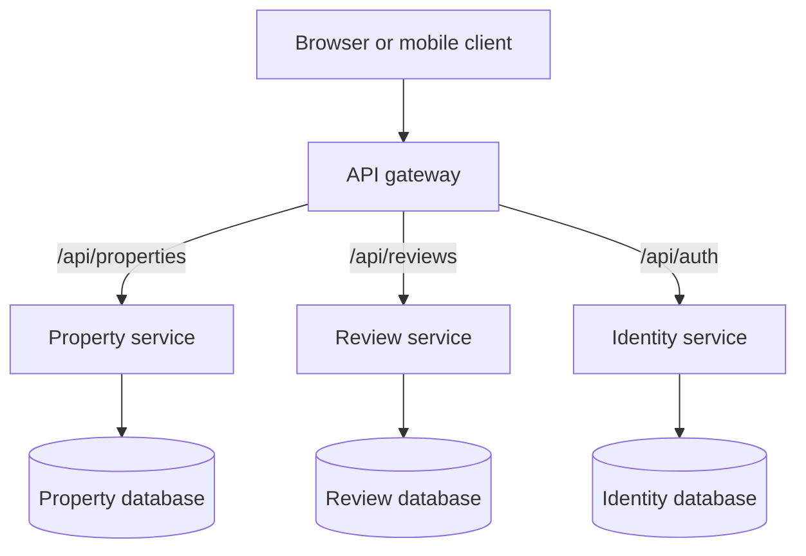
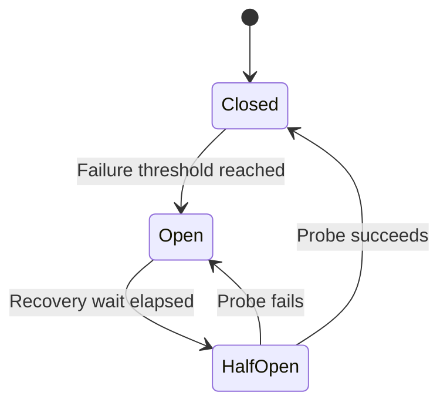

# Microservices Architecture — Node.js & MongoDB

**A practical theory guide: service boundaries, API gateways, routing, configuration, communication, and failure handling.**

This guide assumes you already understand a basic Node.js REST API and MongoDB. Its purpose is to help you explain and design a microservices system. Code is included only when it makes an architectural decision concrete; it is not a complete application or deployment tutorial.

**Priority:** ⭐ means understand this well before moving to advanced patterns.

## Contents

1. [Monolith vs microservices](#1-monolith-vs-microservices)
2. [Service boundaries](#2-service-boundaries)
3. [API gateway and routing](#3-api-gateway-and-routing)
4. [Configuration management](#4-configuration-management)
5. [Service discovery and load balancing](#5-service-discovery-and-load-balancing)
6. [Service-to-service communication](#6-service-to-service-communication)
7. [Database ownership](#7-database-ownership)
8. [Distributed transactions and consistency](#8-distributed-transactions-and-consistency)
9. [Failure handling and resilience](#9-failure-handling-and-resilience)
10. [Idempotency and message reliability](#10-idempotency-and-message-reliability)
11. [Security architecture](#11-security-architecture)
12. [Observability, scaling, and deployment](#12-observability-scaling-and-deployment)
13. [Complete property-review walkthrough](#13-complete-property-review-walkthrough)
14. [Architecture decision checklist](#14-architecture-decision-checklist)
15. [Interview revision questions](#15-interview-revision-questions)
16. [References](#16-references)

## Running example

Imagine a portal where a purchaser requests a review of a property document, a reviewer makes a decision, and participants receive notifications.

| Service | Business responsibility | Data it owns |
|---|---|---|
| Identity | User identity, accounts, and role assignments | Users and identity-related records |
| Property | Property records and document metadata | Properties, document references, document versions |
| Review | Review requests, assignments, and decisions | Reviews, review state, decision history |
| Notification | Delivery of application notifications | Delivery attempts and notification status |

These are teaching boundaries, not a claim that every property application needs four services. Actual boundaries depend on business rules, team ownership, and consistency requirements. Document bytes can live in object storage; Property owns their metadata and access rules.

## 1. Monolith vs microservices

**Priority: ⭐**

  

  
  
# 1. Monolith vs Microservices ⭐

Priority: Very Important | Architecture Fundamentals

## 1.1 What is Monolithic Architecture?

A monolith is an architecture where all major application features are developed and deployed as a single backend application.

Example: A Digital Property Transfer System built using Node.js, Express.js, and MongoDB.

The application contains multiple modules:

- Authentication — login, registration, JWT
- Property — property creation and management
- Documents — document upload and verification
- Reviews — property reviews and feedback
- Payments — payment processing
- Notifications — emails and SMS

All modules run within the same backend application.

React Frontend

Single Node.js Backend

Authentication

Property

Documents

Reviews

Payments

Notifications

MongoDB

Real scenario: If you modify the Reviews module, you normally rebuild and deploy the entire Node.js backend, even when other modules are unchanged.

## 1.2 What is Modular Monolithic Architecture?

A modular monolith is still one application, but its code is organized into separate modules with clear responsibilities.

Example folder structure:

```
src/
 ├── modules/
 │    ├── auth/
 │    ├── property/
 │    ├── documents/
 │    ├── reviews/
 │    └── payments/
 ├── app.ts
 └── server.ts
```

Each module can contain its own controllers, services, models, and routes.

The important distinction is that these modules have clear boundaries but are deployed together.

A modular monolith is often a good starting point when building a new application because it keeps development and deployment simple.

## 1.3 What is Microservices Architecture?

Microservices architecture divides an application into multiple independently deployable backend services, generally organized around business capabilities.

Each service can have its own:

- Business logic and APIs
- Deployment and scaling
- Database ownership
- Configuration
- Monitoring and failure handling

React Frontend

API Gateway

Routes requests to the correct backend service

Auth Service

Auth DB

Property Service

Property DB

Document Service

Document DB

Review Service

Review DB

Payment Service

Payment DB

Notification Service

Notification DB

Conceptual architecture: each service owns its data. Notification delivery may also use an external queue or provider.

Real scenario: If you modify the Reviews service, you can deploy only that service without redeploying the Property, Document, or Payment services, provided their contracts remain compatible.

Microservices are not simply multiple Express applications running on different ports. They require meaningful independence and clear ownership boundaries.

## 1.4 Monolith vs Microservices — Key Differences

| Feature        | Monolith                          | Microservices                             |
| -------------- | --------------------------------- | ----------------------------------------- |
| Application    | One backend application           | Multiple independent services             |
| Deployment     | Entire application                | Individual services                       |
| Communication  | Internal function calls           | HTTP, gRPC, messaging                     |
| Database       | Often shared                      | Each service owns its data                |
| Scaling        | Whole application                 | Individual services                       |
| Failure        | Can affect the entire application | Can be isolated, but may propagate        |
| Debugging      | Generally easier                  | Requires distributed tracing              |
| Infrastructure | Simpler                           | More complex                              |
| Team ownership | Often shared codebase             | Can be service-specific                   |
| Testing        | Easier local integration          | Requires contract and integration testing |

## 1.5 Why Do We Need Microservices?

Consider a Digital Property Transfer application.

Scenario 1 — Independent deployment

You need to add a property rating feature.

- Monolith: Normally rebuild and deploy the complete backend.
- Microservices: Deploy only the Review service.

Scenario 2 — Independent scaling

The Document service processes thousands of large PDF documents and consumes significant CPU resources.

- Monolith: You may need to scale the entire backend.
- Microservices: Increase only the Document service instances.

Scenario 3 — Failure isolation

The Notification service experiences a temporary outage.

- Monolith: A blocking email operation or resource problem may impact the application.
- Microservices: Property operations can continue if notifications are handled asynchronously and failure isolation is designed correctly.

Scenario 4 — Independent teams

Suppose different teams maintain authentication, property management, payments, and document management.

Microservices can allow each team to own, test, and release its service independently.

## 1.6 Disadvantages of Microservices

Microservices also introduce important challenges.

1. Network dependency: Services communicate over networks, so latency and connection failures must be handled.
2. Complex debugging: A single request may travel through multiple services.
3. Data consistency: Updating data across multiple databases requires coordination.
4. Deployment complexity: Multiple services need configuration, deployment, health checks, and monitoring.
5. Communication overhead: Too many service dependencies can create slow or fragile workflows.
6. Higher operational cost: Additional infrastructure, observability, and maintenance are often required.

Example: Creating a property transaction may involve the Property, Document, Payment, and Notification services. If the Payment service fails after another service has saved data, the system needs a clear strategy to handle that partially completed operation.

This is why distributed transactions, Saga patterns, retries, and idempotency are important later in your roadmap.

## 1.7 When Should You Choose Each Architecture?

| Situation                                                       | Better starting choice        |
| --------------------------------------------------------------- | ----------------------------- |
| Small application and small team                                | Modular monolith              |
| New product with frequently changing requirements               | Modular monolith              |
| Simple deployment and maintenance required                      | Modular monolith              |
| Multiple teams need independent releases                        | Microservices                 |
| Different modules require very different scaling                | Microservices                 |
| Some business capabilities need independent failure isolation   | Microservices                 |
| Complex enterprise platform with established service boundaries | Microservices may be suitable |

Important: Application size alone does not determine the architecture. A large, well-structured modular monolith can be better than poorly designed microservices.

## 1.8 Important Microservices Terminology

| Term                   | Simple explanation                                   | Example                                             |
| ---------------------- | ---------------------------------------------------- | --------------------------------------------------- |
| Service                | Independent business capability                      | Review Service                                      |
| Instance               | One running copy of a service                        | Three Review service instances                      |
| API contract           | Agreed request and response structure                | `GET /reviews/:id`                                  |
| Service boundary       | Defines what a service owns                          | Review Service owns reviews                         |
| Loose coupling         | Services depend on each other as little as practical | Review service does not directly modify Property DB |
| Independent deployment | Release one service without redeploying others       | Deploy Review v2 only                               |
| Database ownership     | A service controls its own data                      | Payment Service owns payment records                |

## 1.9 Service vs Instance — Important Concept

Suppose the Review service receives heavy traffic.

You start with one running instance and increase it to three.

Load Balancer

Instance 1

Instance 2

Instance 3

Review Database

These are three instances of one logical Review service, not three different microservices.

This technique is called horizontal scaling.

## 1.10 Interview Questions

1\. What is the main difference between a monolith and microservices?

2\. What is a modular monolith?

3\. Why are microservices useful?

4\. What are the main disadvantages of microservices?

5\. Can microservices share one database?

6\. What is the difference between a service and an instance?

7\. When would you choose a modular monolith?

Key takeaway: Learn microservices as a way to solve specific architectural problems—not as a replacement for every monolith. The most important decision is identifying which business capabilities genuinely need independent deployment, scaling, and ownership.

Next topic: 2. Service Boundaries ⭐ — How to decide whether Property, Documents, Reviews, and Payments should be separate services, including bounded contexts, loose coupling, and avoiding excessive dependencies.## 2. Service boundaries


# 2. Service Boundaries in Microservices ⭐

Service boundary defines what a microservice is responsible for, which business logic and data it owns, and how it communicates with other services.

## 2.1 Divide by Business Capability

Divide microservices based on business responsibilities, not technical layers (controllers, models, database queries).

| Service              | Responsibility                            | Owns               |
| -------------------- | ----------------------------------------- | ------------------ |
| Auth Service         | Login, registration, authentication       | Users, sessions    |
| Property Service     | Property registration and management      | Properties         |
| Document Service     | Upload, verification, document management | Documents          |
| Review Service       | Review assignment, approval, rejection    | Reviews, decisions |
| Payment Service      | Payments and refunds                      | Payments, refunds  |
| Notification Service | Email, SMS, alerts                        | Notification logs  |

Rule: Every service should have one clearly defined business responsibility.

## 2.2 Bounded Context ⭐

A bounded context is a business area where terms, rules, and data models have a specific meaning.

Example: Same person, different context

- Auth Service: User means login credentials, account status, authentication.
- Review Service: Reviewer means assigned reviews, approval permissions, availability.

Both can refer to the same person using `userId`, but maintain their own business models.

Remember: One bounded context does not necessarily mean one microservice.

## 2.3 High Cohesion vs Low Coupling ⭐

| Concept       | Meaning                                | Example                                                         |
| ------------- | -------------------------------------- | --------------------------------------------------------------- |
| High cohesion | Keep related business logic together   | Review creation, approval, rejection, history in Review Service |
| Low coupling  | Minimize dependencies between services | Review calls Property API instead of accessing Property DB      |
| Low cohesion  | Unrelated features grouped together    | Authentication and payment processing in one service            |
| High coupling | Services depend heavily on each other  | Review needs 5 Property API calls for one operation             |

Ideal architecture = High Cohesion + Low Coupling.

## 2.4 Database Ownership

Each service owns and modifies its own data.

Incorrect:

```
Review Service → Property Database
```

Correct:

```
Review Service → Property API → Property Database
```

Example: When a lawyer approves a review:

1. Review Service updates review status and decision history in its database.
2. Review Service publishes `ReviewApproved` event.
3. Property Service consumes the event and updates its own data if required.

Benefit: Independent data ownership and reduced coupling. Related changes within Review can remain in one local transaction.

## 2.5 When Should We Split a Service?

| Question                                         | Why it matters                  |
| ------------------------------------------------ | ------------------------------- |
| Does it have a separate business responsibility? | Clear ownership                 |
| Does it own specific data?                       | Avoid shared database access    |
| Can it deploy independently?                     | Independent releases            |
| Does it need independent scaling?                | Better resource utilization     |
| Does it frequently depend on another service?    | Identify tight coupling         |
| Do related operations require one transaction?   | Keep atomic operations together |
| Does splitting justify additional complexity?    | Avoid unnecessary microservices |

Example: Create a separate Review Service if it has complex workflows, independent deployment needs, or dedicated ownership. Otherwise, keep it inside Property or Conveyancing Service.

## 2.6 Common Service Boundary Mistakes

| Mistake                           | Problem                        | Solution                         |
| --------------------------------- | ------------------------------ | -------------------------------- |
| Too many small services           | Excessive network calls        | Combine related capabilities     |
| Shared database models            | Tight coupling                 | Separate data ownership          |
| Direct DB access                  | Cross-service dependency       | Use APIs/events                  |
| Frequent synchronous calls        | Latency and cascading failures | Reduce calls or use async events |
| Always deploy together            | Weak independence              | Reconsider service boundaries    |
| Duplicate business rules          | Inconsistent behavior          | Define authoritative owner       |
| Too many distributed transactions | Complex recovery               | Keep related data together       |

## 2.7 Interview-Ready Questions

Q1. How do you identify microservice boundaries?

By analyzing business capabilities, bounded contexts, data ownership, high cohesion, low coupling, and independent deployment requirements.

Q2. What is the difference between cohesion and coupling?

- Cohesion measures how closely related operations within a service are.
- Coupling measures how dependent services are on each other.

Q3. What is a bounded context?

A clearly defined business area where domain concepts and rules have consistent meaning.

Q4. Can two microservices share a database?

Yes, but they should maintain clear data ownership. Directly modifying another service's tables or collections should be avoided.

Q5. When should two features remain in one microservice?

When they share tightly related business rules, require frequent atomic updates, or splitting would introduce excessive network communication.

## Final Revision

| Concept                | Remember                           |
| ---------------------- | ---------------------------------- |
| Service Boundary       | Defines service responsibility     |
| Business Capability    | Divide by business function        |
| Bounded Context        | Defines domain-model boundaries    |
| High Cohesion          | Related logic together             |
| Low Coupling           | Minimal service dependencies       |
| Database Ownership     | Each service controls its own data |
| Communication          | APIs or events                     |
| Independent Deployment | Release services separately        |

Golden rule: Design microservices around business capabilities with high cohesion, low coupling, and clear data ownership, not around technical layers or the number of APIs.


## 3. API gateway and routing

**Priority: ⭐ — study this section carefully.**

### 3.1 What is an API gateway?

An API gateway is an entry point for clients. It exposes a client-facing API and routes requests to appropriate backend services. It may apply shared policies or combine responses. The backend services still own their business rules. [3]



The Notification service is absent from this public request diagram because it can consume events internally without exposing a client-facing route.

### 3.2 Follow one request

For `GET /api/reviews/rev-101`:

1. The client contacts the public API address.
2. The gateway matches the path and any applicable method or host rules.
3. Applicable edge policies run, such as identity validation and request-size limits.
4. The gateway sends the request to the logical Review endpoint.
5. Routing infrastructure selects a healthy Review instance.
6. Review checks permission to access `rev-101`, reads its own database, and responds.
7. The gateway returns the response to the client.

The same software may perform steps 4 and 5, or they may be handled by separate components.

### 3.3 Gateway, reverse proxy, load balancer, and BFF

| Term | Main question it answers | Example |
|---|---|---|
| Reverse proxy | Which backend receives this incoming request? | Forward a public route to an internal server |
| API gateway | Which API destination and policies apply? | Route APIs and apply authentication or quotas |
| Load balancer | Which instance receives this request or connection? | Choose Review instance A or B |
| BFF: backend for frontend | What response shape does this client need? | Combine property and review summaries for a dashboard |

These responsibilities can overlap in one product. You do not need a separate component for every term.

### 3.4 Route mappings and path rewriting

| Public request | Internal destination |
|---|---|
| `GET /api/properties/p-101` | `http://property-service:3001/properties/p-101` |
| `POST /api/reviews` | `http://review-service:3002/reviews` |
| `GET /api/reviews?status=PENDING` | `http://review-service:3002/reviews?status=PENDING` |

The example removes only `/api`. The service still receives `/reviews` or `/properties`. Rewriting paths must be an explicit contract; accidentally removing too much creates confusing 404 errors.

### 3.5 Small Node.js gateway example

**Illustration:** Express with the `createProxyMiddleware` API. Service names must resolve on the gateway's network. Authentication is discussed in section 11 and is not implemented in this routing-only example. [4]

```js
// gateway.mjs — routing illustration, not a complete production gateway.
import express from "express";
import { createProxyMiddleware } from "http-proxy-middleware";

const app = express();

const routes = [
  ["/api/properties", process.env.PROPERTY_SERVICE_URL],
  ["/api/reviews", process.env.REVIEW_SERVICE_URL],
];

for (const [prefix, target] of routes) {
  if (!target) throw new Error(`Missing target for ${prefix}`);
  new URL(target); // Reject malformed URLs during startup.

  app.use(createProxyMiddleware({
    // Root mounting makes the full path available to these rules.
    pathFilter: (path) => path === prefix || path.startsWith(`${prefix}/`),
    target,
    changeOrigin: true,
    pathRewrite: { "^/api(?=/|$)": "" },
    proxyTimeout: 3000,
    on: {
      error: (_error, _request, response) => {
        if (response.headersSent) return response.destroy();
        response.writeHead(502, { "Content-Type": "application/json" });
        response.end(JSON.stringify({ error: "Upstream unavailable" }));
      },
    },
  }));
}

app.use((_request, response) => {
  response.status(404).json({ error: "Unknown API route" });
});

app.listen(8080);
```

The exact prefix check avoids routing `/api/reviews-other` to Review. The proxy forwards request bodies as streams; this example does not place a JSON body parser before it. `changeOrigin` changes the upstream Host header—it does not configure CORS or validate identity.

The timeout is a proxy-level control, not a complete end-to-end business deadline. This example maps proxy errors to a generic 502. A complete gateway should classify timeout and availability errors, preserve tracing, enforce size limits, and implement its agreed security policies.

### 3.6 The same route as reverse-proxy configuration

You can also express routing in infrastructure configuration. This NGINX fragment belongs inside a `server` block; HTTP here represents an internal teaching example. [5]

```nginx
location /api/reviews/ {
    proxy_pass http://review-service:3002/reviews/;
    proxy_connect_timeout 1s;
    proxy_read_timeout 3s;
}
```

`/api/reviews/rev-101` becomes `/reviews/rev-101`: the matching location prefix is replaced by the URI part of `proxy_pass`. Configure the collection route `/api/reviews` separately when using this fragment. `proxy_read_timeout` limits inactivity between upstream reads, not total response duration.

This fragment expresses routing; it does not automatically add authentication, service discovery refresh, or active health checks.

### 3.7 What should stay out of the gateway?

Review eligibility, assignment rules, and decision transitions belong in Review. If the gateway updates several databases to approve a review, it has become a business application with hidden ownership.

Small read aggregation can live in a gateway or BFF. For example, a dashboard may combine a property title with a review summary. Decide how partial results are represented if one read fails. Stateful business workflows should have an explicit owner rather than being scattered across proxy routes.

### 3.8 Do internal calls pass through the public gateway?

Usually, a service calls another service through its internal address or internal routing layer. Sending every internal call through the public gateway adds a dependency and extra latency. Internal authentication and authorization still apply. An internal gateway can be useful when there is a deliberate policy or networking reason.

Run multiple gateway instances behind an appropriate entry layer when availability requires it. A single logical entry point does not have to mean a single running process.

## 4. Configuration management

**Priority: important — understand where values come from and how they change.**

### 4.1 What belongs in configuration?

Configuration contains deployment-dependent values: service endpoints, database connection settings, limits, and environment-specific behavior. Keep these separate from application source so the same build can run in different environments. Environment variables are one common delivery mechanism. [6]

| Category | Example | Ownership |
|---|---|---|
| Service-specific | Review concurrency limit | Review team |
| Environment-specific | Internal Property endpoint | Deployment/platform configuration |
| Shared policy | Allowed identity issuer | Security/platform owners with service validation |
| Secret | Database password or signing credential | Restricted secret management |
| Business policy | Which party may approve a review | Domain owner; may be versioned business data |

Business rules that change need clear ownership and auditability. They should not become undocumented environment flags simply because a flag is easy to add.

### 4.2 Example configuration

```dotenv
# Gateway configuration: illustrative internal addresses.
PROPERTY_SERVICE_URL=http://property-service:3001
REVIEW_SERVICE_URL=http://review-service:3002

# Review configuration.
SERVICE_NAME=review-service
PORT=3002
PROPERTY_REQUEST_TIMEOUT_MS=1500
LOG_LEVEL=info
```

Each deployed process receives only the settings it needs. Real credentials should be injected through the chosen secret mechanism rather than committed to source control. A `.env` file is a convenient local input format, not a complete secrets architecture.

### 4.3 Startup validation

```js
// config.mjs — validate a numeric setting before accepting traffic.
const timeoutMs = Number(process.env.PROPERTY_REQUEST_TIMEOUT_MS ?? 1500);

if (!Number.isInteger(timeoutMs) || timeoutMs < 100 || timeoutMs > 10000) {
  throw new Error("PROPERTY_REQUEST_TIMEOUT_MS must be 100–10000");
}

export const config = Object.freeze({ propertyRequestTimeoutMs: timeoutMs });
```

The range is an example policy, not a universal recommendation. Rejecting invalid configuration during startup prevents a typo from silently turning into unlimited waiting or immediate failures.

### 4.4 Startup configuration vs dynamic configuration

| Approach | Behavior | Main trade-off |
|---|---|---|
| Startup snapshot | Read settings when the process starts | Predictable; changes usually require restart or rollout |
| Dynamic configuration | Refresh or receive changes while running | Faster changes; needs validation, versioning, and consistent application |

If the process reads an environment variable into an object at startup, changing deployment configuration does not magically update that object. The platform must replace the process, or the application must explicitly support refreshing.

### 4.5 Centralized configuration: useful, but another dependency

A central configuration service can distribute versioned settings. Avoid making every business request depend on contacting it. A service can obtain a validated snapshot and use it locally.

If the configuration system becomes unavailable, an already-running service might continue with its last known valid snapshot. A new instance without required secrets or a valid initial snapshot should remain unready. Security-sensitive changes need explicit expiry and failure policies; silently using stale settings forever is not a general solution.

For a timeout change, for example: validate the new value, apply it to a small set of instances, observe latency/errors, then expand. Keep the previous configuration version available for rollback.

### 4.6 Configuration vs service discovery

Configuration may say “call `property-service`.” Discovery resolves that stable identity to a reachable endpoint. Configuration names the dependency; discovery handles where its current instances live.

## 5. Service discovery and load balancing

**Priority: ⭐**

### 5.1 Why hardcoded instance addresses fail

An instance may be restarted, moved, scaled up, or replaced during deployment. Its address can change. Clients should generally use a stable service identity rather than embedding each instance's IP.

Two common arrangements:

| Arrangement | Who finds/selects an instance? | Client responsibility |
|---|---|---|
| Client-side discovery | Client discovers instances and chooses one | Registry interaction, balancing, and stale-endpoint handling |
| Server-side discovery | Client calls a stable endpoint; infrastructure selects an instance | Call the endpoint and handle failures |

A platform such as Kubernetes can expose a stable Service abstraction in front of changing application instances. You only need to understand the responsibility here; learning Kubernetes commands is separate. [7]

### 5.2 Separate three questions

1. **Routing:** Is this request for Property or Review?
2. **Discovery:** Where can Review currently be reached?
3. **Balancing:** Which eligible Review instance gets this request?

DNS may help discovery, but DNS alone does not guarantee immediate failover. Caching, connection reuse, and the platform's endpoint handling affect how quickly changes are observed.

### 5.3 Health and traffic eligibility

| Signal | Meaning | Typical consequence |
|---|---|---|
| Liveness | Is the process stuck or unable to make progress? | Restart may be appropriate |
| Readiness | Can this instance serve its intended traffic now? | Include or remove it from traffic routing |
| Startup | Has initialization finished? | Allow startup time before normal probe behavior |

These checks serve different purposes. A failed readiness check should not automatically imply that the process must restart. [8]

**Example:** Review is alive but cannot connect to its own database. It may need to become unready for database-dependent requests. Restarting every Review instance because the database has a temporary outage can make recovery worse.

### 5.4 Practical questions

- **Is `localhost` the other service?** In separate containers, `localhost` normally refers to the current container's network namespace. Use the configured service address.
- **Must every instance use a different port?** No. Separate hosts or containers can use the same internal port. The address and networking arrangement distinguish them.
- **Do health checks guarantee success?** No. An instance can fail immediately after a successful check; clients still need timeouts and failure handling.
- **Do you need sticky sessions?** Prefer externalizing necessary session state so requests can reach any healthy instance. Stickiness can be appropriate for specific protocols, but it should be a conscious constraint.

## 6. Service-to-service communication

**Priority: ⭐**

### 6.1 Synchronous vs asynchronous communication

| Aspect | Synchronous request | Asynchronous message |
|---|---|---|
| Caller expectation | Wait for a response now | Submit work or a fact for processing separately |
| Example | Read the current document version | Notify participants after a review is accepted |
| Availability coupling | Dependency usually must respond now | Consumer can process later, within retention and capacity limits |
| User experience | Immediate success or failure response | May need pending state and later status updates |
| Failure design | Timeouts, bounded retries, fallbacks | Durable delivery, duplicates, retries, backlog handling |

Asynchronous communication reduces immediate waiting; it does not remove dependencies. Consumers still depend on message contracts, and the broker becomes part of the system's reliability design.

### 6.2 Choose based on the business requirement

Use a synchronous call when Review needs an immediate Property response before accepting a request. Use an event when Notification can act after Review commits its decision.

Do not make a read synchronous just because HTTP is familiar, or make everything asynchronous because events sound more scalable. Ask whether the caller needs the result now and what should happen if the dependency is unavailable.

### 6.3 A bounded Node.js service call

```js
// Call-site illustration: baseUrl comes from trusted configuration.
export async function getDocument(baseUrl, documentId, accessToken) {
  const url = new URL(`/documents/${encodeURIComponent(documentId)}`, baseUrl);
  const response = await fetch(url, {
    headers: { Authorization: `Bearer ${accessToken}` },
    signal: AbortSignal.timeout(1500),
  });

  if (!response.ok) {
    throw new Error(`Property service returned HTTP ${response.status}`);
  }

  return response.json();
}
```

Node's abort signal can bound waiting for the operation. `fetch` does not treat an HTTP 404 or 500 as a network rejection, so the example checks the status. [9]

The token must be appropriate for the receiving service; do not blindly forward an unrelated token. The caller must classify errors and decide the business outcome. An abort ends the caller's waiting; it does not guarantee that the remote service stopped work or undid a write.

### 6.4 Commands, events, and queries

| Type | Meaning | Example |
|---|---|---|
| Query | Ask for information | `GetReviewStatus` |
| Command | Ask an owner to perform an action; it may reject it | `AssignReviewer` |
| Event | Announce a fact that has happened | `ReviewAssigned` |

A command can travel over HTTP or a queue. An event's meaning does not depend on one particular consumer doing something with it. Avoid publishing `ReviewApproved` before approval has actually committed.

### 6.5 Event envelope example

```json
{
  "eventId": "evt-8c4f2",
  "eventType": "ReviewRequested",
  "schemaVersion": 1,
  "occurredAt": "2026-10-14T16:30:00Z",
  "aggregateId": "rev-101",
  "aggregateVersion": 1,
  "correlationId": "req-6bd7e",
  "data": {
    "propertyId": "p-101",
    "documentId": "doc-52",
    "documentVersion": 3
  }
}
```

`eventId` identifies the event for deduplication. `schemaVersion` describes the payload contract. `aggregateVersion` describes the sequence of changes to this particular review. They solve different problems.

Include enough information for consumers to do their job, while avoiding unnecessary personal information or document contents. Decide whether a consumer may query the owner for more detail or needs a self-contained snapshot.

### 6.6 Queue vs publish/subscribe

- **Competing consumers:** Several Notification instances consume the same queue to share work. A delivery is handled by one consumer at a time, but it can be redelivered after failure.
- **Publish/subscribe:** Notification and an audit capability each need their own copy of an event. Give each independent subscriber a delivery path, such as its own queue.

Putting unrelated subscribers on one shared work queue can accidentally distribute events between them instead of delivering each event to both.

### 6.7 Avoid long synchronous chains

If Gateway waits for Review, Review waits for Property, and Property waits for Identity, one slow dependency affects the whole request. Reduce unnecessary calls, cache only where freshness rules allow, or maintain local read projections. A local projection improves independence but introduces freshness and rebuild responsibilities.

## 7. Database ownership

**Priority: ⭐**

### 7.1 What does database-per-service mean?

The important rule is ownership: a service controls its persistent data, schema, and access contract. Other services use its API or events instead of directly changing its records. Separate database servers are one implementation option, not a requirement for every service. [10]

For learning, one MongoDB deployment can host `property_db`, `review_db`, and `identity_db`, each with restricted service credentials. This establishes logical ownership while still sharing infrastructure and its capacity/failure risks.

### 7.2 What should another service store?

Review can store `propertyId`, `documentId`, and `documentVersion`. It may also store an intentional snapshot, such as the document title when review began, if the business needs historical evidence.

| Data | Owner | Possible copy in Review |
|---|---|---|
| Current property title | Property | Display projection with a freshness policy |
| Document version metadata | Property | Reference to the exact reviewed version |
| Review decision | Review | Authoritative record stays in Review |
| Notification delivery status | Notification | Usually not needed for deciding review correctness |

A reference across service-owned databases is not automatically a foreign-key guarantee. Plan for a record being deleted, access being revoked, or a dependency being temporarily unavailable.

### 7.3 Why not share Mongoose models?

If Review imports Property's model and queries its collections, it becomes dependent on Property's schema and can bypass business rules. A later Property schema change may break Review even if the public API remains stable.

Shared libraries for generic logging or contract types may be useful. Shared mutable domain models and database repositories create much stronger coupling.

### 7.4 How do you combine data across services?

| Approach | Useful when | Cost |
|---|---|---|
| API composition | A small number of current reads must be combined | Latency and availability depend on the called services |
| Event-fed read model | A dashboard needs frequent combined reads | Eventual consistency, rebuilds, and event processing |
| Reporting pipeline | Analytics spans many capabilities | Data freshness and separate pipeline operations |

Do not make a cross-service MongoDB `$lookup` a hidden application dependency simply because databases happen to share infrastructure.

### 7.5 MongoDB transactions: the exact boundary

MongoDB supports multi-document transactions on supported replica-set and sharded deployments; a standalone server does not provide that transaction setup. A transaction can cover collections and databases within its supported deployment scope. [11]

That technical capability does not make it a good ownership boundary across independently managed services. It also cannot atomically commit a MongoDB change together with an arbitrary HTTP call, email, or broker publication. Use local transactions for local invariants; coordinate the wider workflow explicitly.

## 8. Distributed transactions and consistency

**Priority: ⭐**

### 8.1 The partial-success problem

Suppose a workflow accepts a review and then reserves a reviewer slot in a separately owned scheduling capability. The first update succeeds; the second fails. There is no ordinary local database rollback that reaches backward through both independent owners and every external side effect.

Even a simpler workflow has a similar gap: Review saves a record, then crashes before publishing `ReviewRequested`. Notification never learns about the committed request.

These are different problems. **Saga** coordinates a business workflow across owners. **Outbox** addresses reliable publication alongside a local database update.

### 8.2 Strong and eventual consistency

- **Strong consistency:** Reads obey an agreed guarantee about seeing committed writes; exact guarantees depend on the data system and operation settings.
- **Eventual consistency:** Copies converge when updates are successfully propagated and no newer changes intervene. The delay is not automatically bounded.

For this portal, Review is authoritative for the decision. A dashboard projection can temporarily lag, but it should expose an honest pending state where needed. An irreversible signing decision should not be based on an unverified stale projection.

### 8.3 Saga: a sequence of local business steps

A saga coordinates local transactions. If a later step cannot complete, earlier successful steps may need compensating business actions. Orchestration uses a coordinator; choreography has participants react to events. [12]

| Approach | How it works | Main concern |
|---|---|---|
| Orchestration | A workflow owner records progress and requests each step | Coordinator logic, durable state, and recovery |
| Choreography | Services react to events and emit further events | The complete flow can become hard to follow |

**Hypothetical example:** Review creates a pending assignment, a scheduling owner reserves a slot, then Review confirms the assignment. If the reservation is rejected, Review cancels the pending assignment. These are explicit states with a durable record of progress.

Compensation is not a time machine. A sent notification cannot be unsent; a correction may be required. Compensation can also fail, so the workflow needs retries, visibility, and sometimes manual resolution. A notification failure alone usually should not reverse an otherwise valid review request.

### 8.4 Transactional outbox

Store the business update and a pending event in one local database transaction. A separate publisher reads pending events and sends them to the broker. A crash after publishing but before marking completion can cause duplicate publication, so consumers still need idempotency. [13]

```text
ARCHITECTURE PSEUDOCODE — not executable application code

Within one transaction in Review's database:
    insert review with status PENDING
    insert outbox event ReviewRequested with a stable eventId
Commit both together

Outbox publisher:
    claim an unpublished event using a recoverable lease
    publish it and wait for the configured broker confirmation
    verify routing succeeded under the broker's routing policy
    mark it published
    retry safely when the outcome is uncertain
```

Do not perform the external publication inside the database transaction callback and assume it rolls back with MongoDB. The broker is outside that transaction. Keep outbox records until your retention and recovery policy allows cleanup, and monitor the oldest pending event.

### 8.5 Concurrency: two reviewers act at once

Optimistic concurrency accepts a write only if the record is still at the version the caller read.

```js
// MongoDB Node driver illustration; reviews is an existing collection.
export async function approveReview(reviews, reviewId, expectedVersion) {
  const result = await reviews.updateOne(
    { _id: reviewId, version: expectedVersion, status: "PENDING" },
    { $set: { status: "APPROVED" }, $inc: { version: 1 } }
  );

  if (result.matchedCount === 0) {
    throw new Error("Review changed, is missing, or is no longer pending");
  }
}
```

This protects this single review transition; it is not a distributed lock. Production behavior must also check authorization and distinguish relevant failure cases. If the transition produces an event, update the review and insert the outbox record in the same local transaction.

### 8.6 The check-then-act race across services

Review checks document version 3. Before it saves the review, Property creates version 4. A successful HTTP check did not lock Property's data.

Define the business rule explicitly: allow a review of immutable version 3, or require the authoritative owner to reserve/validate the version as part of a coordinated operation. A last-second check alone cannot eliminate every race between independent writes.

## 9. Failure handling and resilience

**Priority: ⭐**

### 9.1 Think about partial failures

A service may be healthy while its dependency is slow. A request may commit successfully even though its response is lost. A broker may accept an event while the publisher fails before observing confirmation.

Therefore, “I received an error” and “nothing happened” are different statements.

### 9.2 Timeouts and deadlines

A timeout bounds one wait. An end-to-end deadline bounds the total time available to the workflow. If a request has 3 seconds left, starting three sequential 2-second attempts is not useful.

**Illustrative budget:** 3 seconds for the whole request, with up to 1.5 seconds for a Property call, leaving time for database work and the response. Choose real values from measured latency and business requirements, including connection and response behavior. [14]

### 9.3 Retries with backoff and jitter

Retry only when the failure is plausibly temporary and the operation is safe to repeat. Increase the delay between attempts, add randomness to avoid synchronized retry bursts, and cap both attempts and total time. Retrying at several layers can multiply traffic during an outage. [14]

| Failure | Typical decision |
|---|---|
| Invalid request data | Correct the request; do not retry unchanged |
| User lacks permission | Do not blindly retry |
| Temporary connection failure on a read | A bounded retry may help |
| Timed-out creation request | Retry only with an idempotency contract or reconcile the result |
| Rate limit response | Respect the documented retry guidance and deadline |
| Business rejection | Follow the business outcome; repeated calls will not fix it |

For example, delays of roughly 200 ms, 400 ms, and 800 ms with jitter illustrate the shape; they are not recommended defaults for every API. One layer should normally own the retry policy for a given operation.

### 9.4 Circuit breaker

A circuit breaker temporarily stops calls to a dependency that is repeatedly failing. It gives the dependency time to recover and avoids repeatedly consuming caller resources. A later limited probe checks whether calls can resume. [15]



“Closed” means calls flow normally; “open” means they are rejected locally. A breaker does not fix the dependency and does not replace timeouts.

### 9.5 Bulkheads, backpressure, and graceful degradation

| Technique | Purpose | Portal example |
|---|---|---|
| Bulkhead | Limit how much one dependency consumes | Cap concurrent calls to the document-processing dependency |
| Backpressure | Keep incoming work within processing capacity | Limit unacknowledged jobs and stop accepting unlimited work |
| Graceful degradation | Preserve safe useful behavior | Display the review while showing notification status as temporarily unavailable |

Do not use “approved” as a fallback when approval verification failed. A fallback must preserve the meaning of the business operation.

### 9.6 Cache freshness is an architecture decision

A cache can reduce dependency calls, but cached data can be stale. Define who fills it, its expiry, invalidation strategy, and whether stale data is acceptable. Authorization, ownership, and signing eligibility often need stricter freshness than a display title.

When a cache misses, the source of truth remains the owner service. A cache should not quietly become a second, conflicting authority.

## 10. Idempotency and message reliability

**Priority: ⭐**

### 10.1 What is idempotency?

For an operation's defined scope, repeating the same request has the same intended business effect as performing it once. It does not necessarily mean every response byte or timestamp is identical.

Setting a review to a specified state may be naturally repeatable. Creating a new review on every retry is not. Even an apparently repeatable update can emit duplicate notifications unless its side effects are also protected.

### 10.2 HTTP idempotency keys

```http
POST /api/reviews HTTP/1.1
Authorization: Bearer <access-token>
Idempotency-Key: review-request-8fdb2
Content-Type: application/json

{"propertyId":"p-101","documentId":"doc-52","documentVersion":3}
```

The client reuses the same key when retrying the same operation. Review owns the deduplication decision because it owns creation.

An implementation needs:

1. A scoped unique key, such as tenant/user + operation + idempotency key.
2. A canonical request fingerprint to detect a changed payload using the same key.
3. An atomic claim so two simultaneous requests cannot both create a review.
4. Durable state for in-progress and completed outcomes, with a recovery strategy.
5. A retention period aligned with the supported retry window.

For a MongoDB-only creation, the idempotency result, review, and outbox event can be committed in one local transaction. If external effects are involved, track workflow state rather than pretending they fit inside that transaction. Reusing a key with a different payload should be rejected according to the API's documented conflict behavior.

### 10.3 Idempotent event consumers

A consumer can record processed event IDs alongside its own business update. The record and update must be atomic, with a uniqueness constraint; a simple “check, then write” without concurrency protection is insufficient. [16]

```text
ARCHITECTURE PSEUDOCODE — local database effects only

Begin transaction in consumer's database
    insert unique marker (consumerName, eventId)
    apply the local business update
Commit transaction
Acknowledge the message

If the marker already exists from a committed transaction:
    treat the event as already handled and acknowledge it
If processing fails:
    roll back and follow the bounded retry policy
```

If the process crashes after commit but before acknowledgement, redelivery finds the committed marker. An external email is outside the consumer's database transaction; it needs a delivery workflow and, where available, provider idempotency. This pattern alone cannot guarantee an external email is sent exactly once.

### 10.4 Delivery guarantees and acknowledgements

| Term | What to understand |
|---|---|
| At-most-once | Delivery may be lost; delivery retries are not used to recover it |
| At-least-once | A delivery may repeat; design consumers for duplicates |
| Exactly-once claims | Examine the precise system boundary and effect covered |
| Publisher confirm | Broker acknowledges publication under its configured semantics |
| Consumer acknowledgement | Consumer reports successful handling of a delivery |

Publisher confirms and consumer acknowledgements are separate. A confirm does not mean a consumer completed the business action. Durable queues, persistent messages, replication, routing checks, and acknowledgement behavior must be configured together for the required reliability. [17]

### 10.5 Dead-letter queues and poison messages

A permanently invalid message should not loop through immediate retries forever. After the agreed retry policy, quarantine it in a dead-letter or failure path, alert on it, and preserve enough information to diagnose the problem.

A dead-letter queue is not the recovery plan by itself. Decide who fixes the cause, who authorizes replay where necessary, and how replay avoids duplicate effects.

### 10.6 Ordering and reconciliation

Parallel consumers, retries, and redeliveries can change processing order. Do not assume global ordering. Use an entity key and versions when the business requires changes to one review to be applied in order.

A late full-state event can sometimes be ignored if a newer version is already applied. A sequence of incremental changes may instead require detecting gaps and recovering missing events. “Ignore anything old” is not a universal rule.

Reconciliation finds work that has been pending too long, compares it with authoritative state, and repairs or escalates inconsistencies. For the portal, periodically detect reviews whose outbox events remain unpublished or whose workflow step has stalled.

## 11. Security architecture

**Priority: important — identity must remain trustworthy across boundaries.**

### 11.1 Authentication vs authorization

Authentication establishes who is calling. Authorization decides whether that caller may perform a particular action on a particular resource.

For example, a valid login token does not mean a lawyer may read every purchaser's documents. Review must check the caller's assignment or resource permissions before returning a review.

### 11.2 Gateway and service responsibilities

| Component | Responsibility |
|---|---|
| Identity provider/service | Authenticate users and issue identity credentials |
| Gateway | Enforce its edge identity and traffic policies |
| Review service | Verify trusted identity context and enforce review permissions |
| Property service | Enforce property/document access rules |
| Internal network controls | Limit which workloads can reach which endpoints |

Authorization belongs close to the resource and business rule. Gateway checks do not remove the need for service-level enforcement. Internal traffic also needs a trust model rather than an assumption that every reachable caller is safe. [18]

### 11.3 Propagating user identity

One arrangement forwards an appropriate signed token that services validate. Another uses a gateway-verified identity context over authenticated internal connections. Either requires protection against forged identity headers and direct gateway bypass.

For JWTs, decoding the payload is not verification. Validate the signature using trusted keys, permitted algorithms, issuer, audience, and time-related claims according to the token profile. Key rotation and stale role claims require explicit handling. A signed token's payload is not automatically encrypted. [18]

### 11.4 User identity vs workload identity

A request can involve two identities: the Review service making a call, and the user on whose behalf it acts. The receiving service should know which authority the call uses. A background consumer may act as a workload without an active user token.

Avoid casually sharing one powerful signing secret among every service. Choose a verification and key-management arrangement that limits who can issue credentials. Also restrict broker publish/consume rights and database permissions per service.

### 11.5 Practical boundaries

- Terminate and protect transport encryption according to the deployment's trust boundaries.
- Treat client-supplied identity and forwarding headers as untrusted unless a trusted boundary replaces or validates them.
- Scope rate limits to the business need; a limit held only in one gateway instance changes when the gateway scales.
- Keep tokens, credentials, personal documents, and unnecessary personal data out of logs.
- Remember that CORS controls browser cross-origin access; it is not API authorization.

## 12. Observability, scaling, and deployment

**Priority: important — the architecture must be operable after it is deployed.**

### 12.1 Logs, metrics, and traces

| Signal | Best question | Example |
|---|---|---|
| Logs | What happened in this operation? | A specific review transition failed |
| Metrics | How often, how slow, or how much? | Error rate, latency, queue depth |
| Traces | Where did the request spend time? | Gateway → Review → Property spans |

A correlation ID helps find related records. Distributed tracing propagates trace context so work in different services can be connected into a trace. Context can travel through HTTP headers and message metadata. [19]

```json
{
  "level": "info",
  "service": "review-service",
  "event": "review_created",
  "reviewId": "rev-101",
  "correlationId": "req-6bd7e",
  "durationMs": 84
}
```

This is a structured log, not a complete distributed trace. Avoid putting unbounded identifiers such as every `reviewId` into metric labels; use them in logs or traces where appropriate.

Monitor user outcomes as well as infrastructure: successful review creation, failed decisions, oldest unpublished outbox event, age of pending workflows, and notification delivery lag. A healthy CPU graph does not prove the business flow works.

### 12.2 Scaling services independently

| Service | Possible scaling pressure | What to check first |
|---|---|---|
| Property | High read traffic | Query/index performance and safe caching |
| Review | API traffic or slow database operations | Latency, concurrency, and database capacity |
| Notification | Growing delivery backlog | Oldest message age, provider limits, retry rate |

More instances do not always improve throughput. Each additional instance may open a database connection pool or increase calls to an already overloaded provider.

Keep authoritative state outside replaceable process memory. Process-local variables are unsuitable for shared review state, global idempotency records, or workflow progress. Local ephemeral caches can still be useful if their loss is safe.

### 12.3 Compatible changes and deployment

During a rolling deployment, old and new instances can coexist. APIs, events, and stored data must tolerate that overlap.

An **expand-and-contract** change first adds a compatible field or capability, updates consumers, migrates data when needed, and only later removes the old representation. Adding an optional field is often easier than renaming a required field or changing its meaning.

Consumers should follow a documented compatibility policy. An API version in a URL does not by itself make a breaking change safe. Contract tests help verify that producer and consumer expectations still agree.

Code rollback may not reverse a data migration, emitted event, or external action. Plan rollback and forward-repair options before incompatible changes.

### 12.4 Graceful shutdown

On shutdown, an instance should stop accepting new work, leave the ready endpoint set, drain in-flight requests within a deadline, finish or safely release claimed messages, and then close connections. Abrupt termination remains possible, so idempotency and recovery are still required.

### 12.5 Architecture-level validation

Test scenarios that cross boundaries: an upstream timeout, a response lost after commit, duplicate event delivery, an outbox publisher restart, and old/new event consumers running together. Backups, restore procedures, and the ability to rebuild projections are also part of recovery design.

## 13. Complete property-review walkthrough

Use this example to connect the concepts rather than learning each term separately.

### 13.1 Normal request flow

1. **Client:** Sends `POST /api/reviews` with a valid credential, document version 3, and an idempotency key.
2. **Gateway:** Matches the route, applies its edge policies, strips `/api`, and forwards to the internal Review endpoint.
3. **Discovery/balancing:** The stable endpoint routes the request to an eligible Review instance.
4. **Review:** Establishes the caller's identity and permissions. It checks the document through Property with a bounded request, using credentials valid for Property.
5. **Business rule:** This example reviews an immutable document version. A later version does not silently change what was submitted.
6. **Local commit:** Review atomically stores the request, idempotency result, and `ReviewRequested` outbox event in its own MongoDB transaction.
7. **Response:** The client receives the created review ID and `PENDING` status. The review resource exists, so `201 Created` is appropriate. Notification delivery is not being claimed as complete.
8. **Publication:** The outbox publisher sends the event and records confirmed, correctly routed publication. An uncertain outcome is retried with the same event ID.
9. **Notification:** The consumer handles the event with deduplication, tracks the delivery workflow, and acknowledges at the agreed durable processing boundary.
10. **Operations:** Logs and trace context connect the work. Monitoring detects stuck outbox events or delayed delivery.

If an endpoint only accepts a command for later creation instead, `202 Accepted` with a status resource may better describe that different contract. Choose the response from what has actually happened.

### 13.2 What happens when something fails?

| Failure point | Expected architectural behavior |
|---|---|
| Gateway cannot reach Review | Return the agreed availability error; client retries only within the operation's idempotency contract |
| Property check times out | Do not claim the check succeeded; reject temporarily or record a pending verification workflow if the product explicitly supports it |
| MongoDB transaction fails | No partial review/outbox commit from that transaction; return or recover according to the error |
| Review commits, but the response is lost | Retry with the same key returns the recorded outcome instead of creating another review |
| Broker is unavailable after commit | Review remains created; the durable outbox waits and retries; alert if delay exceeds the agreed target |
| Event is published twice | Consumer deduplication prevents a repeated protected local effect |
| Notification provider times out | Delivery state remains uncertain or pending; reconcile or retry using the provider's supported idempotency behavior |
| Reviewer submits an outdated decision | Version/state check rejects the conflict; reload before deciding again |

### 13.3 Where each responsibility belongs

| Decision | Owner |
|---|---|
| Public URL mapping | Gateway |
| Current endpoint/instance selection | Discovery and routing infrastructure |
| Valid property document/version | Property |
| Whether a review may be created or approved | Review |
| Whether a retry creates a second review | Review's idempotency contract |
| When and how delivery is retried | Notification |
| Whether a delayed notification reverses a review | Explicit business policy, not the broker |

## 14. Architecture decision checklist

For each service and workflow, write short answers to these questions:

- [ ] What business capability does this service own?
- [ ] Which data and invariants belong to it?
- [ ] Which operations require an immediate response?
- [ ] Which changes can propagate asynchronously?
- [ ] How does a caller discover and authenticate the service?
- [ ] Where are routing rules, settings, and secrets configured?
- [ ] What is the timeout and retry policy for each dependency?
- [ ] What happens if a request commits but its response is lost?
- [ ] What prevents duplicate or out-of-order effects?
- [ ] Which database update and event must be coordinated using an outbox?
- [ ] Does the workflow need a saga, or is a local commit plus later notification enough?
- [ ] Which stale reads are acceptable, and which decisions require authoritative state?
- [ ] What will the client see while work is pending or partially unavailable?
- [ ] How will you detect, investigate, and repair a stuck workflow?
- [ ] Can old and new service versions run together safely?

## 15. Interview revision questions

Use the right-hand column as an answer outline, then explain each answer using the property-review example.

| Question | Key points to include |
|---|---|
| Why choose microservices? | Specific autonomy, scaling, or isolation benefit; acknowledge distributed-system cost |
| How do you decide service boundaries? | Business capability, ownership, local invariants, limited coupling |
| Is a service the same as a server? | One logical service can have many instances across servers |
| What does an API gateway do? | Client entry point, routing, shared edge policy; domain rules remain in services |
| Gateway vs load balancer? | Destination/policy selection vs instance/connection distribution; responsibilities may overlap |
| What is service discovery? | Resolve a stable service identity to current reachable endpoints |
| Does changing an environment variable update a running process? | Not automatically; startup snapshot vs explicit dynamic refresh |
| Should all internal calls use the public gateway? | Usually no; use the designed internal route and trust model |
| REST or events? | Need for immediate result, availability coupling, workflow and recovery requirements |
| Can services share one MongoDB deployment? | Yes, while maintaining logical ownership and permissions; infrastructure risks remain shared |
| Why avoid cross-service database access? | It bypasses ownership and couples callers to internal schemas |
| Saga vs outbox? | Cross-owner business coordination vs atomic local update plus eventual event publication |
| Does timeout mean the write failed? | No; outcome can be uncertain, requiring idempotency or reconciliation |
| Why can an event be delivered twice? | Publisher/consumer crashes and uncertain acknowledgements can trigger retries |
| How do you implement idempotency correctly? | Scoped identity, uniqueness, atomic effect/result recording, concurrency and retention policy |
| What is a circuit breaker? | Stop calls after repeated failures, then probe recovery; still use timeouts |
| Is gateway authentication enough? | Services need trustworthy identity context and resource-level authorization |
| Liveness vs readiness? | Process recovery signal vs eligibility to receive traffic |
| What is eventual consistency? | Asynchronous copies converge; define freshness, pending states, and recovery |
| How do you deploy independently? | Compatible API/event/schema contracts, gradual rollout, observability, rollback/repair plan |

**Suggested study order:** First master boundaries, gateways, configuration, discovery, and communication (sections 1–6). Then focus on ownership, consistency, and failure handling (sections 7–10). Finish with security and operations (sections 11–12), and explain the complete walkthrough without looking at the notes.

## 16. References

Primary documentation and original pattern descriptions used to verify technical details. The portal examples and suggested design choices are illustrations, not descriptions of an existing system. Links were checked while preparing this guide on 14 October 2026.

1. [Martin Fowler — Monolith First](https://martinfowler.com/bliki/MonolithFirst.html)
2. [Microservices.io — Decompose by business capability](https://microservices.io/patterns/decomposition/decompose-by-business-capability.html)
3. [Microservices.io — API Gateway / Backends for Frontends](https://microservices.io/patterns/apigateway.html)
4. [http-proxy-middleware — Maintainer documentation](https://github.com/chimurai/http-proxy-middleware)
5. [NGINX — HTTP proxy module and URI rewriting](https://nginx.org/en/docs/http/ngx_http_proxy_module.html)
6. [The Twelve-Factor App — Configuration](https://12factor.net/config)
7. [Kubernetes — Service abstraction](https://kubernetes.io/docs/concepts/services-networking/service/)
8. [Kubernetes — Liveness, readiness, and startup probes](https://kubernetes.io/docs/concepts/workloads/pods/probes/)
9. [Node.js — Global APIs, fetch, and AbortSignal](https://nodejs.org/api/globals.html)
10. [Microservices.io — Database per service](https://microservices.io/patterns/data/database-per-service.html)
11. [MongoDB — Transactions](https://www.mongodb.com/docs/manual/core/transactions/)
12. [Microservices.io — Saga](https://microservices.io/patterns/data/saga.html)
13. [Microservices.io — Transactional outbox](https://microservices.io/patterns/data/transactional-outbox.html)
14. [AWS Builders' Library — Timeouts, retries, and backoff with jitter](https://aws.amazon.com/builders-library/timeouts-retries-and-backoff-with-jitter/)
15. [Microsoft Azure Architecture Center — Circuit breaker](https://learn.microsoft.com/en-us/azure/architecture/patterns/circuit-breaker)
16. [Microservices.io — Idempotent consumer](https://microservices.io/patterns/communication-style/idempotent-consumer.html)
17. [RabbitMQ — Consumer acknowledgements and publisher confirms](https://www.rabbitmq.com/docs/confirms)
18. [OWASP — Microservices security](https://cheatsheetseries.owasp.org/cheatsheets/Microservices_Security_Cheat_Sheet.html)
19. [OpenTelemetry — Context propagation](https://opentelemetry.io/docs/concepts/context-propagation/)
