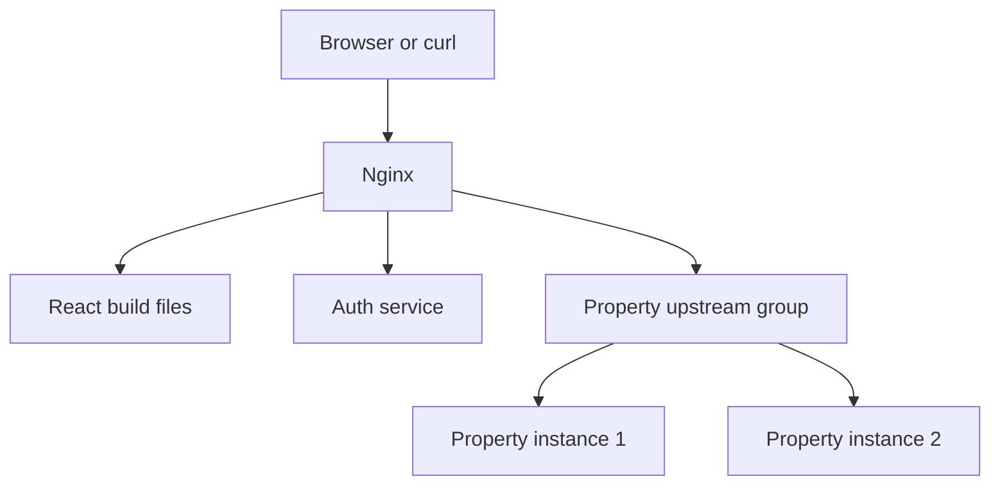

# Nginx: Complete Learning and Docker Practice Guide

**For:** a React / Node.js developer learning Nginx and microservices routing.  
**Scope:** beginner through intermediate, with optional public-domain HTTPS.  
**Practice location:** your own computer. AWS is not required.  
**Command environment:** Bash in Ubuntu / WSL, macOS Terminal, or Linux.  
**Prepared:** 18 October 2026.

> Read the sections in order. Every file needed for the local lab is included below. Create the files at the named paths, copy each complete file block, and run commands from the `nginx-lab` directory unless a step says otherwise. Later steps explicitly tell you which file or block to replace.

## Contents

1. [Roadmap and time](#1-roadmap-and-time)
2. [Understand the architecture](#2-understand-the-architecture)
3. [Install the tools](#3-install-the-tools)
4. [Learn the Docker basics](#4-learn-the-docker-basics)
5. [Create the complete starting project](#5-create-the-complete-starting-project)
6. [Run and test the first setup](#6-run-and-test-the-first-setup)
7. [Understand Nginx configuration and routing](#7-understand-nginx-configuration-and-routing)
8. [Build and serve a React frontend](#8-build-and-serve-a-react-frontend)
9. [Add load balancing](#9-add-load-balancing)
10. [Configure local HTTPS](#10-configure-local-https)
11. [Logs, timeouts, uploads, and rate limiting](#11-logs-timeouts-uploads-and-rate-limiting)
12. [Complete final local configuration](#12-complete-final-local-configuration)
13. [Optional: a real domain and trusted HTTPS](#13-optional-a-real-domain-and-trusted-https)
14. [Troubleshooting and everyday commands](#14-troubleshooting-and-everyday-commands)
15. [Practice checklist and interview revision](#15-practice-checklist-and-interview-revision)
16. [Official references and validation scope](#16-official-references-and-validation-scope)

---

## 1. Roadmap and time

| Order | Topic | Main outcome |
| --- | --- | --- |
| 1 | Basics | Explain web server, reverse proxy, and load balancer |
| 2 | Installation and commands | Start, stop, inspect, test, and reload Nginx |
| 3 | Configuration ⭐ | Understand `nginx.conf`, `http`, `server`, `location`, `listen`, and `server_name` |
| 4 | Reverse proxy and routing ⭐ | Route Auth and Property API requests to the correct service |
| 5 | React frontend | Build React and serve its static files with client-side route fallback |
| 6 | Load balancing ⭐ | Distribute requests across two instances of the Property service |
| 7 | HTTPS | Set up local TLS, then understand a real-domain certificate workflow |
| 8 | Troubleshooting and protection | Diagnose errors and configure timeouts, body limits, and rate limiting |

| Level | Suggested time | Target |
| --- | --- | --- |
| Beginner | 2–3 hours | Understand concepts and run the first reverse proxy |
| Intermediate | Another 6–9 hours | Complete React hosting, routing, load balancing, and local HTTPS |
| Additional practice | As needed | Repeat failure drills, add protection, and try public-domain HTTPS |

The earlier **8–12 hours** is an estimate for the core local exercises. First-time Docker installation, detailed troubleshooting, and real-server deployment may take extra time. You do not need to master Docker or AWS first.

A practical order is four sessions: tools and first proxy; configuration and React; load balancing and HTTPS; troubleshooting and revision.

## 2. Understand the architecture

### 2.1 What is Nginx?

Nginx is software that receives network requests. In this guide it performs three jobs:

| Role | Meaning | Our example |
| --- | --- | --- |
| Web server | Returns files directly | Returns the React build: HTML, CSS, and JavaScript |
| Reverse proxy | Forwards a request to an application and returns its response | Sends `/api/auth/me` to the Auth service |
| Load balancer | Selects one backend instance from a group | Sends Property requests to `property1` or `property2` |

**Reverse proxy** describes forwarding on behalf of servers. A **forward proxy** forwards on behalf of clients, such as a company proxy used for outgoing internet requests.

Nginx does not execute your Node.js business logic. Node.js continues to handle application behavior. For React, the browser runs the JavaScript after Nginx sends the built files.

### 2.2 What you will build



There are **two business services**: Auth and Property. Property has **two instances of the same service**, not two different microservices. We start both instances in Docker, but initially Nginx sends Property traffic only to instance 1. We activate balancing later.

These demo services use plain Node.js with ES modules and no database or external backend packages. This keeps the lab focused on Nginx. An Express service would occupy exactly the same place in the architecture.

The Auth service only returns sample data: it does **not** implement login, passwords, or JWT validation.

### 2.3 Ports and addresses

| From where? | Address | Meaning |
| --- | --- | --- |
| Your browser | `http://localhost:8080` | HTTP entry point on your computer |
| Your browser, after the TLS lesson | `https://localhost:8443` | HTTPS entry point on your computer |
| Inside Docker | `http://auth:3001` | Auth container, using its Compose service name |
| Inside Docker | `http://property1:3002` | First Property instance |
| Inside Docker | `http://property2:3002` | Second Property instance |

Both Property containers can use port `3002` because they have separate network environments. Only Nginx publishes ports to your computer.

**Important:** inside the Nginx container, `localhost` means the Nginx container itself. It does not mean another container or your laptop. Use the Compose names above to reach other services.

### 2.4 Is Nginx an API gateway?

Nginx can provide gateway functions such as routing, TLS termination, and rate limiting. A broader API gateway may also provide authentication integration, API keys, quotas, transformations, and analytics.

For this lab, Nginx performs the routing directly. You do not need an extra Express gateway using `http-proxy-middleware`. In a larger system, both can coexist when the extra gateway has a clear responsibility.

## 3. Install the tools

### 3.1 What you need

| Tool | Required? | Purpose |
| --- | --- | --- |
| Docker Desktop on Windows/macOS, or Docker Engine + Compose on Linux | Yes | Runs Nginx and Node in containers |
| VS Code or another editor | Yes | Creates configuration and source files |
| Browser | Yes | Opens the frontend |
| Bash terminal | Yes for the commands in this guide | Runs Docker, curl, and shell commands |
| `curl` | Yes for API exercises | Checks status codes, headers, and responses |
| OpenSSL | For the local HTTPS lesson | Generates a local certificate |
| Node.js/npm installed on your computer | No | Node and the frontend build run inside Docker |
| Postman | Optional | Graphical API testing |
| AWS, MongoDB, Redis, Kubernetes | No | Not needed for this lab |
| Domain name | Only for optional public HTTPS | Gives a publicly reachable server a DNS name |

### 3.2 Windows setup: Docker Desktop with WSL 2

1. Check the current [Docker Desktop Windows prerequisites](https://docs.docker.com/desktop/setup/install/windows-install/). Hardware virtualization must be available and enabled.
2. Open **PowerShell as Administrator** and install WSL if it is not already installed:

```powershell
wsl --install -d Ubuntu
```

3. Restart Windows if requested. Open Ubuntu and finish creating your Linux username and password.
4. Install Docker Desktop from Docker's official website. Use its WSL 2 backend and Linux containers.
5. Open Docker Desktop. In Settings, enable WSL integration for your Ubuntu distribution. Menu labels can vary by version.
6. Keep Docker Desktop running. Open the **Ubuntu terminal** for the remaining steps.
7. Install the small command-line tools in Ubuntu:

```bash
sudo apt update
sudo apt install -y ca-certificates curl openssl
```

8. Check Docker from that Ubuntu terminal:

```bash
docker version
docker compose version
docker run --rm hello-world
```

Expected: Docker shows both client and server information, Compose prints a version, and the test container prints a success message.

If Docker reports that it cannot connect to the daemon, open Docker Desktop and check WSL integration. Do not install a second Docker daemon inside WSL just to fix the integration.

**Shell rule:** only the WSL installation command above uses PowerShell. Run the rest in Ubuntu/Bash. Windows PowerShell has different quoting, line continuation, and sometimes a different `curl` command.

### 3.3 macOS and Linux

- **macOS:** install [Docker Desktop](https://docs.docker.com/desktop/setup/install/mac-install/), launch it, and use Terminal. Check `curl --version` and `openssl version`. For the certificate command later, use an OpenSSL version supporting `-addext`; a compatible Homebrew OpenSSL installation is one option if your bundled version does not.
- **Linux:** follow the [Docker Engine installation guide](https://docs.docker.com/engine/install/) for your distribution and install the Compose plugin. Use `docker compose`, with a space. Ensure your account can access Docker, or consistently use `sudo docker`.

### 3.4 Create a workspace

From your Bash terminal:

```bash
mkdir -p ~/nginx-lab
cd ~/nginx-lab
mkdir -p auth property nginx/conf.d nginx/snippets web frontend/src certs backups
```

Open this directory in your editor. With VS Code's WSL integration, `code .` can open it from Ubuntu. You can also create the files manually through the editor.

The first image downloads require internet access. Once images and dependencies are available locally, the basic lab does not require a cloud account.

## 4. Learn the Docker basics

### 4.1 Five words to remember

| Term | Meaning in this lab |
| --- | --- |
| Image | A packaged filesystem and instructions used to create a container |
| Container | A running instance of an image |
| Dockerfile | Instructions for building an image |
| Compose | A YAML description of several related containers |
| Bind mount | Makes a host file/directory visible inside a container |

A port mapping such as `127.0.0.1:8080:80` means: accept connections on your computer's loopback address at port `8080`, and forward them to container port `80`.

Using `127.0.0.1` keeps this practice entry point on your machine. Public deployment uses different bindings later.

### 4.2 Run Nginx by itself first

```bash
docker run --rm -d --name nginx-check -p 127.0.0.1:8080:80 nginx:stable-alpine
curl -I http://localhost:8080
docker exec nginx-check nginx -t
docker logs nginx-check
docker stop nginx-check
```

You should see HTTP `200` and a successful configuration test. You can also open `http://localhost:8080` in your browser before stopping it.

`--rm` removes this temporary container when it stops. Stopping it frees port `8080` for the project below.

We use `nginx:stable-alpine` and `node:24-alpine` as convenient learning image tags. Tags can change over time; these are not immutable version pins. For a repeatable production build, retain dependency lockfiles and pin validated image digests.

## 5. Create the complete starting project

### 5.1 File map

Create these files now. React files are added in section 8.

| Path relative to `nginx-lab` | Purpose |
| --- | --- |
| `compose.yaml` | Runs all four containers |
| `auth/server.mjs` | Sample Auth API |
| `auth/Dockerfile` | Packages the Auth API |
| `property/server.mjs` | Sample Property API, reused by both instances |
| `property/Dockerfile` | Packages the Property API |
| `Dockerfile.gateway` | Builds the Nginx image |
| `.dockerignore` | Excludes unnecessary or private files from the gateway build context |
| `web/index.html` | First static page |
| `nginx/conf.d/app.conf` | Routing configuration |
| `nginx/snippets/proxy-common.conf` | Shared proxy headers and timeouts |
| `certs/` | Empty initially; local certificate files go here later |

### 5.2 Auth API

**File: `auth/server.mjs` — complete contents**

```javascript
import http from 'node:http';

const port = Number(process.env.PORT || 3001);

function json(res, status, body) {
  res.writeHead(status, { 'Content-Type': 'application/json' });
  res.end(JSON.stringify(body));
}

const server = http.createServer((req, res) => {
  const url = new URL(req.url, 'http://internal');
  const path = url.pathname;
  console.log(req.method, req.url);

  if (req.method === 'GET' && path === '/health') {
    return json(res, 200, { status: 'ok', service: 'auth' });
  }

  if (req.method === 'GET' && ['/auth', '/auth/', '/auth/me'].includes(path)) {
    return json(res, 200, {
      service: 'auth',
      user: { id: 'U101', name: 'Shivam', role: 'PURCHASER' }
    });
  }

  if (req.method === 'GET' && path === '/auth/headers') {
    return json(res, 200, {
      host: req.headers.host,
      realIp: req.headers['x-real-ip'],
      forwardedFor: req.headers['x-forwarded-for'],
      forwardedProto: req.headers['x-forwarded-proto'],
      forwardedHost: req.headers['x-forwarded-host']
    });
  }

  // Learning endpoint: count bytes without storing an uploaded file.
  if (req.method === 'POST' && path === '/auth/echo') {
    let bytes = 0;
    req.on('data', chunk => { bytes += chunk.length; });
    req.on('end', () => json(res, 200, { receivedBytes: bytes }));
    req.on('error', () => res.destroy());
    return;
  }

  return json(res, 404, { error: 'Auth route not found', path });
});

server.listen(port, '0.0.0.0', () => {
  console.log(`Auth listening on ${port}`);
});

process.on('SIGTERM', () => server.close(() => process.exit(0)));
```

`.mjs` enables ES modules without a `package.json`. Binding to `0.0.0.0` lets other containers connect to this service. The health endpoint is for container readiness.

### 5.3 Property API

**File: `property/server.mjs` — complete contents**

```javascript
import http from 'node:http';

const port = Number(process.env.PORT || 3002);
const instance = process.env.INSTANCE_NAME || 'property-1';
const properties = [
  { id: 'P101', address: 'Sample Property A', ownerId: 'U101' },
  { id: 'P102', address: 'Sample Property B', ownerId: 'U102' }
];

function json(res, status, body) {
  res.writeHead(status, { 'Content-Type': 'application/json' });
  res.end(JSON.stringify({ instance, ...body }));
}

const server = http.createServer((req, res) => {
  const url = new URL(req.url, 'http://internal');
  const path = url.pathname;
  console.log(instance, req.method, req.url);

  if (req.method !== 'GET') {
    return json(res, 405, { error: 'Only GET is supported in this demo' });
  }

  if (path === '/health') {
    return json(res, 200, { status: 'ok' });
  }

  if (path === '/properties' || path === '/properties/') {
    return json(res, 200, { properties });
  }

  // Learning endpoint for timeout experiments. Delay is capped at 10 seconds.
  if (path === '/properties/slow') {
    const requested = Number(url.searchParams.get('ms') || 4000);
    const delay = Number.isFinite(requested)
      ? Math.min(Math.max(requested, 0), 10000)
      : 4000;
    setTimeout(() => {
      if (!res.destroyed) json(res, 200, { delayMs: delay });
    }, delay);
    return;
  }

  const property = properties.find(item => path === `/properties/${item.id}`);
  if (property) return json(res, 200, { property });

  return json(res, 404, { error: 'Property route not found', path });
});

server.listen(port, '0.0.0.0', () => {
  console.log(`${instance} listening on ${port}`);
});

process.on('SIGTERM', () => server.close(() => process.exit(0)));
```

The same file runs twice. `INSTANCE_NAME` changes the response so you can see which container handled a request.

### 5.4 Dockerfiles for the APIs

**File: `auth/Dockerfile` — complete contents**

```dockerfile
FROM node:24-alpine
WORKDIR /app
COPY --chown=node:node server.mjs ./server.mjs
USER node
EXPOSE 3001
CMD ["node", "server.mjs"]
```

**File: `property/Dockerfile` — complete contents**

```dockerfile
FROM node:24-alpine
WORKDIR /app
COPY --chown=node:node server.mjs ./server.mjs
USER node
EXPOSE 3002
CMD ["node", "server.mjs"]
```

`EXPOSE` documents the intended port. It does not publish that port to your laptop. Docker runs the Node process directly; you do not need PM2 inside these containers.

### 5.5 Initial static page and Nginx image

**File: `web/index.html` — complete contents**

```html
<!doctype html>
<html lang="en">
  <head>
    <meta charset="UTF-8">
    <meta name="viewport" content="width=device-width, initial-scale=1.0">
    <title>Nginx Practice</title>
  </head>
  <body>
    <h1>Nginx is serving this page</h1>
    <p>Next: test the Auth and Property APIs.</p>
    <a href="/api/auth/me">Auth API</a>
    <a href="/api/properties">Property API</a>
  </body>
</html>
```

**File: `Dockerfile.gateway` — initial complete contents**

```dockerfile
FROM nginx:stable-alpine
COPY web/ /usr/share/nginx/html/
```

**File: `.dockerignore` — complete contents**

```text
.git
**/node_modules
**/dist
certs
certbot
backups
*.log
.env
.env.*
```

Certificates are supplied as runtime mounts, not baked into the image.

### 5.6 Shared proxy settings

**File: `nginx/snippets/proxy-common.conf` — complete contents**

```nginx
proxy_http_version 1.1;
proxy_set_header Connection "";
proxy_set_header Host $host;
proxy_set_header X-Real-IP $remote_addr;
proxy_set_header X-Forwarded-For $proxy_add_x_forwarded_for;
proxy_set_header X-Forwarded-Proto $scheme;
proxy_set_header X-Forwarded-Host $http_host;

proxy_connect_timeout 3s;
proxy_send_timeout 30s;
proxy_read_timeout 30s;
```

This file is included inside each proxy location. Setting `Connection` to an empty value removes that hop-specific header for these ordinary HTTP requests; WebSocket upgrades require a separate configuration.

### 5.7 Initial Nginx routing

**File: `nginx/conf.d/app.conf` — initial complete contents**

```nginx
log_format lab '$remote_addr "$request" status=$status '
               'upstream=$upstream_addr upstream_status=$upstream_status '
               'request_time=$request_time upstream_time=$upstream_response_time';

upstream auth_backend {
    server auth:3001;
}

upstream property_backend {
    server property1:3002;
}

server {
    listen 80 default_server;
    server_name localhost;

    access_log /dev/stdout lab;
    error_log /dev/stderr warn;
    client_max_body_size 1m;

    location = /healthz {
        default_type text/plain;
        return 200 "nginx ok\n";
    }

    location = /api/auth {
        include /etc/nginx/lab-snippets/proxy-common.conf;
        proxy_pass http://auth_backend/auth;
    }

    location ^~ /api/auth/ {
        include /etc/nginx/lab-snippets/proxy-common.conf;
        proxy_pass http://auth_backend/auth/;
    }

    location = /api/properties {
        include /etc/nginx/lab-snippets/proxy-common.conf;
        proxy_pass http://property_backend/properties;
    }

    location ^~ /api/properties/ {
        include /etc/nginx/lab-snippets/proxy-common.conf;
        proxy_pass http://property_backend/properties/;
    }

    location /api/ {
        default_type application/json;
        return 404 '{"error":"Unknown API route"}';
    }

    location / {
        root /usr/share/nginx/html;
        index index.html;
        try_files $uri $uri/ =404;
    }
}
```

This routes both `/api/properties` and paths below `/api/properties/`. Unknown API paths receive `404` instead of accidentally returning the frontend HTML.

### 5.8 Docker Compose

**File: `compose.yaml` — complete contents, used throughout the local lab**

```yaml
name: nginx-lab

services:
  auth:
    build: ./auth
    environment:
      PORT: "3001"
    healthcheck:
      test: ["CMD", "node", "-e", "fetch('http://127.0.0.1:3001/health').then(r => process.exit(r.ok ? 0 : 1)).catch(() => process.exit(1))"]
      interval: 5s
      timeout: 3s
      retries: 10
      start_period: 5s

  property1:
    build: ./property
    environment:
      PORT: "3002"
      INSTANCE_NAME: property-1
    healthcheck:
      test: ["CMD", "node", "-e", "fetch('http://127.0.0.1:3002/health').then(r => process.exit(r.ok ? 0 : 1)).catch(() => process.exit(1))"]
      interval: 5s
      timeout: 3s
      retries: 10
      start_period: 5s

  property2:
    build: ./property
    environment:
      PORT: "3002"
      INSTANCE_NAME: property-2
    healthcheck:
      test: ["CMD", "node", "-e", "fetch('http://127.0.0.1:3002/health').then(r => process.exit(r.ok ? 0 : 1)).catch(() => process.exit(1))"]
      interval: 5s
      timeout: 3s
      retries: 10
      start_period: 5s

  nginx:
    image: nginx-lab-gateway:local
    build:
      context: .
      dockerfile: Dockerfile.gateway
    ports:
      - "127.0.0.1:8080:80"
      - "127.0.0.1:8443:443"
    volumes:
      - ./nginx/conf.d:/etc/nginx/conf.d:ro
      - ./nginx/snippets:/etc/nginx/lab-snippets:ro
      - ./certs:/etc/nginx/certs:ro
    depends_on:
      auth:
        condition: service_healthy
      property1:
        condition: service_healthy
      property2:
        condition: service_healthy
```

Notes:

- Compose creates a shared default network. Its service names become usable hostnames on that network.
- We deliberately publish only Nginx ports. Backends are reached through the container network.
- `:ro` means the mounted directory is read-only inside the container; you edit files on your computer.
- Mounting the whole `conf.d` directory replaces the image's default site configuration.
- Health checks let Nginx wait until the services are ready at startup. They are not Nginx traffic health checks and do not provide automatic failover by themselves.
- Port `8443` is reserved now. HTTPS will work only after we add a TLS listener.
- The default image's main `nginx.conf` stays in place. We put our application settings in the directory it includes.

## 6. Run and test the first setup

### 6.1 Validate and start

Run from `~/nginx-lab`:

```bash
docker compose config
docker compose up -d --build --wait
docker compose ps
docker compose exec nginx nginx -t
```

The first build downloads images. You should see four running containers, healthy API containers, and a successful Nginx configuration test.

If Nginx exits before `exec` can run:

```bash
docker compose logs --tail=100 nginx
docker compose run --rm --no-deps nginx nginx -t
```

The second command starts a temporary container to test the configuration. Keep the API containers running because upstream names must resolve for this configuration.

### 6.2 Test each route

```bash
curl -i http://localhost:8080/
curl -i http://localhost:8080/healthz
curl -i http://localhost:8080/api/auth/me
curl -i http://localhost:8080/api/auth/headers
curl -i http://localhost:8080/api/properties
curl -i http://localhost:8080/api/properties/P101
curl -i http://localhost:8080/api/unknown
```

| Request | Expected result |
| --- | --- |
| `/` | `200`, initial HTML page |
| `/healthz` | `200`, `nginx ok` |
| `/api/auth/me` | `200`, sample user |
| `/api/auth/headers` | `200`, forwarded headers |
| `/api/properties` | `200`, property list and `instance: property-1` |
| `/api/properties/P101` | `200`, single property |
| `/api/unknown` | `404`, JSON error |

The request for `/api/auth/me` reaches the backend as `/auth/me`. The `/api` prefix is removed by the URI mapping in `proxy_pass`.

### 6.3 Read the logs

```bash
docker compose logs --tail=50 nginx auth property1 property2
docker compose logs -f nginx
```

Press `Ctrl+C` to stop following logs; the containers keep running.

### 6.4 Apply a configuration change

Save the edited `.conf` file, then run:

```bash
docker compose exec nginx nginx -t
docker compose exec nginx nginx -s reload
```

**Run the reload only if the test succeeds.** Reload lets Nginx adopt a valid configuration while existing workers finish active work. Editing a file alone does not apply it.

For an application source or Dockerfile change, rebuild the relevant image. After recreating API containers, reload Nginx so this simple configuration resolves their current addresses:

```bash
docker compose up -d --build --wait
docker compose exec nginx nginx -t
docker compose exec nginx nginx -s reload
```

A backend container's IP can change when recreated. This lab uses startup/reload name resolution; it does not configure dynamic upstream DNS updates.

## 7. Understand Nginx configuration and routing

### 7.1 Configuration hierarchy

Inspect the actual configuration instead of guessing its location:

```bash
docker compose exec nginx nginx -T
```

The default image has a main file at `/etc/nginx/nginx.conf`. Its structure is approximately:

```nginx
# Conceptual example only: do not replace the image's main file with this.
worker_processes auto;

events {
    worker_connections 1024;
}

http {
    include /etc/nginx/mime.types;
    include /etc/nginx/conf.d/*.conf;
}
```

Because `app.conf` is included **inside `http`**, it can contain `server`, `upstream`, and `log_format`. Do not wrap `app.conf` in another `http` block. `events` belongs in the main configuration, not inside `conf.d`.

| Directive/context | Meaning |
| --- | --- |
| `http` | HTTP-wide configuration |
| `server` | A virtual server for particular ports/names |
| `listen 80` | Accept HTTP connections on container port 80 |
| `server_name localhost` | Match the requested host name; does not create a DNS record |
| `location` | Choose how to handle a URL path |
| `upstream` | Name a group of backend servers |
| `proxy_pass` | Forward a request to a backend |
| `root` | Base directory for files served from disk |
| `index` | Default index filename for a directory |
| `include` | Read another configuration file in the current context |

A simple directive ends with `;`. A block contains `{ ... }`. Nginx's master process manages configuration/workers; workers handle requests.

### 7.2 Location matching

For this lab, remember these cases:

| Pattern | Meaning |
| --- | --- |
| `location = /healthz` | Exact path only |
| `location /api/` | Prefix match |
| `location ^~ /api/auth/` | Prefix match that skips regex checks if it is the longest matching prefix |
| `location ~ pattern` | Case-sensitive regular expression; optional later topic |
| `location /` | Broad fallback prefix |

Nginx first checks exact matches. Otherwise it remembers the longest prefix, with regex handling depending on modifiers. Location blocks are not an Express middleware chain that all run in file order.

We use both an exact location for `/api/properties` and a prefix location for `/api/properties/`. This avoids accidental matching of names such as `/api/propertiesXYZ`.

### 7.3 `proxy_pass`: the trailing slash matters ⭐

These alternatives assume an ordinary prefix location and no rewrites or variables in `proxy_pass`:

```nginx
location /api/auth/ {
    proxy_pass http://auth_backend/auth/;
}
```

| Incoming URL | `proxy_pass` value | Backend path |
| --- | --- | --- |
| `/api/auth/me` | `http://auth_backend` | `/api/auth/me` |
| `/api/auth/me` | `http://auth_backend/` | `/me` |
| `/api/auth/me` | `http://auth_backend/auth/` | `/auth/me` |

When `proxy_pass` includes a URI, that URI replaces the matching location prefix. Without a URI, the request path is preserved in this simple case. Query parameters are preserved in our examples.

Our backend defines `/auth/me`, so the third option matches our intended route. A slash is not merely cosmetic.

### 7.4 Forwarding headers

| Header | Why it is sent |
| --- | --- |
| `Host` | Original host name in this configuration |
| `X-Real-IP` | Address Nginx sees for the connecting client |
| `X-Forwarded-For` | Existing forwarded chain with the connecting address appended |
| `X-Forwarded-Proto` | `http` or `https` at Nginx |
| `X-Forwarded-Host` | Incoming Host header, including its port when supplied |

Check them at `/api/auth/headers`. Docker Desktop may make the observed address a gateway address rather than the value you expected.

Applications must trust forwarded headers only from their trusted proxy path. An incoming client can supply its own `X-Forwarded-For`; blindly trusting the first address is unsafe. For a single public edge, overwriting that header with `$remote_addr` is an alternative. If you later use Express, configure its `trust proxy` for your actual topology.

Reference: [Nginx proxy module](https://nginx.org/en/docs/http/ngx_http_proxy_module.html).

## 8. Build and serve a React frontend

**Goal:** Nginx returns the compiled React files and proxies `/api/...` on the same origin.

### 8.1 Create the React files

We use a small Vite build. The dependency ranges below are learning choices, not claims that these are the newest versions. The generated lockfile records the versions actually selected.

**File: `frontend/package.json` — complete contents**

```json
{
  "name": "nginx-practice-frontend",
  "version": "1.0.0",
  "private": true,
  "type": "module",
  "scripts": {
    "build": "vite build"
  },
  "dependencies": {
    "react": "^19.0.0",
    "react-dom": "^19.0.0",
    "react-router-dom": "^7.0.0"
  },
  "devDependencies": {
    "vite": "^7.0.0"
  }
}
```

**File: `frontend/index.html` — complete contents**

```html
<!doctype html>
<html lang="en">
  <head>
    <meta charset="UTF-8">
    <meta name="viewport" content="width=device-width, initial-scale=1.0">
    <title>Nginx Practice Dashboard</title>
  </head>
  <body>
    <div id="root"></div>
    <script type="module" src="/src/main.jsx"></script>
  </body>
</html>
```

**File: `frontend/src/main.jsx` — complete contents**

```jsx
import React from 'react';
import { createRoot } from 'react-dom/client';
import App from './App.jsx';
import './style.css';

createRoot(document.getElementById('root')).render(<App />);
```

**File: `frontend/src/App.jsx` — complete contents**

```jsx
import React, { useState } from 'react';
import { BrowserRouter, Link, Route, Routes } from 'react-router-dom';

function ApiPanel() {
  const [result, setResult] = useState(null);
  const [error, setError] = useState('');
  const [loading, setLoading] = useState(false);

  async function load(path) {
    setLoading(true);
    setError('');
    setResult(null);
    try {
      const response = await fetch(path);
      if (!response.ok) throw new Error(`HTTP ${response.status}`);
      setResult(await response.json());
    } catch (err) {
      setError(err.message);
    } finally {
      setLoading(false);
    }
  }

  return (
    <section>
      <h2>Test your APIs</h2>
      <div className="actions">
        <button disabled={loading} onClick={() => load('/api/auth/me')}>Load user</button>
        <button disabled={loading} onClick={() => load('/api/properties')}>Load properties</button>
        <button disabled={loading} onClick={() => load('/api/auth/headers')}>View proxy headers</button>
      </div>
      {loading && <p role="status">Loading...</p>}
      {error && <p role="alert">{error}</p>}
      {result && <pre>{JSON.stringify(result, null, 2)}</pre>}
    </section>
  );
}

export default function App() {
  return (
    <BrowserRouter>
      <main>
        <h1>Nginx practice dashboard</h1>
        <nav><Link to="/">Home</Link><Link to="/dashboard">Dashboard</Link></nav>
        <Routes>
          <Route path="/" element={<p>Open the dashboard to test Nginx routing.</p>} />
          <Route path="/dashboard" element={<ApiPanel />} />
          <Route path="*" element={<p>Frontend page not found.</p>} />
        </Routes>
      </main>
    </BrowserRouter>
  );
}
```

**File: `frontend/src/style.css` — complete contents**

```css
body { margin: 0; font-family: system-ui, sans-serif; background: #f2f5fa; color: #17243a; }
main { max-width: 850px; margin: 48px auto; padding: 28px; background: white; border-radius: 16px; }
nav, .actions { display: flex; flex-wrap: wrap; gap: 12px; margin: 20px 0; }
a { color: #165ac7; }
button { padding: 10px 16px; border: 0; border-radius: 8px; background: #165ac7; color: white; cursor: pointer; }
button:disabled { opacity: .5; cursor: wait; }
pre { padding: 20px; background: #13243c; color: #dcecff; border-radius: 10px; overflow: auto; }
[role="alert"] { color: #b02323; }
@media (max-width: 600px) { main { margin: 16px; padding: 20px; } }
```

### 8.2 Generate the lockfile using Docker

Run from the project root:

```bash
docker run --rm --user "$(id -u):$(id -g)" -e npm_config_cache=/tmp/npm-cache -v "$PWD/frontend:/app" -w /app node:24-alpine npm install --package-lock-only
```

This creates `frontend/package-lock.json`. It requires access to the npm registry. The user flag avoids root-owned generated files on Linux/WSL.

### 8.3 Replace the gateway Dockerfile

**Replace all of `Dockerfile.gateway` with:**

```dockerfile
FROM node:24-alpine AS frontend-build
WORKDIR /app
COPY frontend/package.json frontend/package-lock.json ./
RUN npm ci
COPY frontend/ ./
RUN npm run build

FROM nginx:stable-alpine
COPY --from=frontend-build /app/dist/ /usr/share/nginx/html/
```

The first build stage compiles React. The final image contains Nginx and the compiled files. Node is not needed to serve this particular frontend because it is a static SPA, not an SSR application.

### 8.4 Replace the frontend location

In `nginx/conf.d/app.conf`, replace only the existing `location /` block with:

```nginx
location / {
    root /usr/share/nginx/html;
    index index.html;
    try_files $uri $uri/ /index.html;
}
```

Add this **separate sibling location inside the same `server` block** so missing Vite assets return a real `404`:

```nginx
location ^~ /assets/ {
    root /usr/share/nginx/html;
    try_files $uri =404;
}
```

`try_files` checks the requested file, then a directory, then serves `index.html` when neither exists. React Router can then handle `/dashboard` in the browser.

Keep the `/api/` locations. Their errors must not fall back to HTML.

### 8.5 Rebuild and test

```bash
docker compose up -d --build --wait
docker compose exec nginx nginx -t
curl -I http://localhost:8080/dashboard
curl -i http://localhost:8080/assets/missing.js
```

Open `http://localhost:8080/dashboard` in your browser. Click the API buttons. Refresh the page while still on `/dashboard`.

Expected:

- The dashboard opens and survives a direct refresh.
- API buttons return JSON.
- `/assets/missing.js` returns `404`.
- The browser requests `/api/...` on the same host and port as the frontend.

Because frontend and API share an origin, this setup needs no additional CORS headers. A separate Vite development server on another port would be a different setup.

Reference: [Vite static deployment](https://vite.dev/guide/static-deploy.html) and [Docker multi-stage builds](https://docs.docker.com/build/building/multi-stage/).

## 9. Add load balancing

### 9.1 Enable both Property instances

Replace the entire `property_backend` block in `app.conf` with:

```nginx
upstream property_backend {
    server property1:3002 max_fails=1 fail_timeout=5s;
    server property2:3002 max_fails=1 fail_timeout=5s;
}
```

Both instances already run in Compose. Only the proxy configuration changes.

```bash
docker compose exec nginx nginx -t
docker compose exec nginx nginx -s reload
```

### 9.2 Observe the responses

```bash
for i in $(seq 1 10); do
  curl -sS http://localhost:8080/api/properties
  printf '\n'
done
```

You should observe both `property-1` and `property-2`. Default balancing is round robin, but do not require perfect alternation in this small test: workers, other requests, failures, and connections can affect the sequence.

### 9.3 Try least connections

Add `least_conn;` inside the same upstream group, before the server lines:

```nginx
upstream property_backend {
    least_conn;
    server property1:3002 max_fails=1 fail_timeout=5s;
    server property2:3002 max_fails=1 fail_timeout=5s;
}
```

Test and reload again. This favors the server with fewer active connections. A sequence of very fast requests is not a convincing demonstration of the difference; it becomes more meaningful with concurrent, uneven-duration work.

For the final reference configuration, we return to round robin so the simplest behavior remains visible.

### 9.4 Simulate a failed instance

```bash
docker compose stop property1
curl -i http://localhost:8080/api/properties
docker compose logs --tail=20 nginx
docker compose start property1
```

Nginx can retry an eligible GET on the other upstream when a connection fails. The logs may contain the failed attempt even when the final response is `200`.

`max_fails` and `fail_timeout` provide **passive** failure handling: Nginx learns from attempted requests. They do not actively poll `/health`. Wait a few seconds after restarting the container before judging recovery.

Do not assume every in-flight request can be retried or that failover guarantees zero errors. Retrying writes requires careful application-level idempotency.

### 9.5 What changes in a real application?

- Both Property instances implement the same API and business rules.
- Important shared state cannot live only in one process's memory.
- Uploads usually need shared/object storage if several instances access them.
- Session state may need a shared store or an appropriate token design.
- Two instances on one laptop do not protect against the laptop itself failing.

Reference: [Nginx upstream module](https://nginx.org/en/docs/http/ngx_http_upstream_module.html).

## 10. Configure local HTTPS

**Goal:** practice TLS on `https://localhost:8443`, without a paid server or domain.

### 10.1 Understand TLS termination

The browser establishes HTTPS with Nginx. Nginx decrypts the request and forwards it to Node using HTTP on the lab's container network. This is TLS termination.

That does not make the internal hop encrypted. A real system may also require TLS between Nginx and its backends.

### 10.2 Generate a local self-signed certificate

From the project root:

```bash
openssl req -x509 -nodes -newkey rsa:2048 -sha256 -days 30 \
  -keyout certs/localhost.key \
  -out certs/localhost.crt \
  -subj "/CN=localhost" \
  -addext "subjectAltName=DNS:localhost,IP:127.0.0.1"
```

This creates a private key and a certificate with localhost subject alternative names. The key has no passphrase so Nginx can start unattended; keep the private key private.

The `certs` directory is already mounted at `/etc/nginx/certs` in the container.

### 10.3 Back up the HTTP configuration

```bash
cp nginx/conf.d/app.conf backups/app-http.conf
```

Keep backups **outside** `conf.d`. A backup ending in `.conf` inside that directory would also be loaded.

### 10.4 Enable the TLS listener

In your existing application `server` block:

1. Replace `listen 80 default_server;` with the following lines.
2. Keep the `server_name`, logging, API locations, and React locations in that same block.

```nginx
listen 443 ssl default_server;
ssl_certificate /etc/nginx/certs/localhost.crt;
ssl_certificate_key /etc/nginx/certs/localhost.key;
ssl_protocols TLSv1.2 TLSv1.3;
```

Then add a **new sibling server block** in `app.conf`, outside the TLS server:

```nginx
server {
    listen 80 default_server;
    server_name localhost;
    return 308 https://localhost:8443$request_uri;
}
```

The redirect deliberately uses `8443`, the host HTTPS port for this lab. Redirecting to the ordinary HTTPS port `443` would send your browser to the wrong port on your computer.

Test and reload:

```bash
docker compose exec nginx nginx -t
docker compose exec nginx nginx -s reload
```

### 10.5 Test HTTPS properly

```bash
curl -I http://localhost:8080/dashboard
curl --cacert certs/localhost.crt -i https://localhost:8443/api/auth/me
curl --cacert certs/localhost.crt -i https://localhost:8443/api/auth/headers
```

Expected:

- HTTP responds with `308` and a `Location` containing `https://localhost:8443/dashboard`.
- HTTPS returns the API JSON.
- The headers endpoint reports `forwardedProto: https`.

Your browser will normally warn because this self-signed certificate is not in its trusted roots. For this localhost experiment only, use the browser's local exception if it offers one, or continue testing with `curl --cacert`.

`curl -k` disables certificate verification; it is a troubleshooting shortcut for this local lab, not a production solution. A browser-trusted local certificate can instead be created with a development CA tool such as mkcert, but it is not needed for the exercise.

To return to HTTP later:

```bash
cp backups/app-http.conf nginx/conf.d/app.conf
docker compose exec nginx nginx -t
docker compose exec nginx nginx -s reload
```

For the next section, keep HTTPS enabled.

Reference: [Nginx HTTPS configuration](https://nginx.org/en/docs/http/configuring_https_servers.html).

## 11. Logs, timeouts, uploads, and rate limiting

These drills use your local HTTPS setup. The example limits are intentionally small for learning; choose real values from application requirements.

### 11.1 Understand the logs

```bash
docker compose logs --tail=100 nginx
docker compose logs --tail=50 auth property1 property2
```

Our access log reports the final status, upstream address/status, total request time, and upstream response time. A failed attempt followed by a retry can produce multiple upstream values.

Access logs answer **what request happened?** Error logs help answer **why did something fail?** The Node logs show the path after Nginx's mapping.

`nginx -t` checks configuration syntax and referenced resources; it does not prove your API behaves correctly. Use HTTP tests as well.

### 11.2 Diagnose 502 Bad Gateway

Stop the single Auth backend:

```bash
docker compose stop auth
curl --cacert certs/localhost.crt -i https://localhost:8443/api/auth/me
docker compose logs --tail=20 nginx
docker compose start auth
```

Expected while Auth is stopped: usually `502` with an upstream connection failure. Restart it and retry after it is ready.

Common causes include a stopped application, incorrect upstream port, wrong protocol, or a backend that closes the connection incorrectly.

### 11.3 Understand timeout settings and create a 504

| Setting | What it limits |
| --- | --- |
| `proxy_connect_timeout` | Establishing the upstream connection |
| `proxy_send_timeout` | Inactivity between successive writes to the upstream |
| `proxy_read_timeout` | Inactivity between successive reads from the upstream |

A read timeout is **not a total request deadline**. A streaming backend that keeps sending data can remain connected longer.

Temporarily change `proxy_read_timeout 30s;` to `proxy_read_timeout 1s;` in `nginx/snippets/proxy-common.conf`. Test and reload, then run:

```bash
curl --cacert certs/localhost.crt -i 'https://localhost:8443/api/properties/slow?ms=4000'
```

Expected: `504 Gateway Timeout` because the response remains silent too long. Nginx may first try another eligible backend, so total elapsed time can exceed one second.

Restore `proxy_read_timeout 30s;`, test and reload, and repeat the request. It should return `200` after the simulated delay.

### 11.4 Test the request body limit

The application server block already has:

```nginx
client_max_body_size 1m;
```

Generate temporary files and send them to the byte-counting endpoint:

```bash
head -c 2048 /dev/zero > /tmp/nginx-small.bin
head -c 2097152 /dev/zero > /tmp/nginx-large.bin

curl --cacert certs/localhost.crt -i \
  --data-binary @/tmp/nginx-small.bin https://localhost:8443/api/auth/echo

curl --cacert certs/localhost.crt -i \
  --data-binary @/tmp/nginx-large.bin https://localhost:8443/api/auth/echo
```

Expected: the small body returns `200` and `receivedBytes: 2048`; the larger body returns `413 Content Too Large` (wording may vary).

To allow larger uploads, change the limit, for example to `10m`, and reload. Apply a compatible limit in your application too. Nginx's limit applies to the whole request body, including multipart overhead; it is not a per-file validation rule.

### 11.5 Add request rate limiting

At the top level of `app.conf`, **outside every server block**, add:

```nginx
limit_req_zone $binary_remote_addr zone=auth_limit:10m rate=5r/s;
```

Inside the HTTPS application server, add:

```nginx
limit_req_status 429;
```

Inside **both** Auth proxy locations (`location = /api/auth` and `location ^~ /api/auth/`), add:

```nginx
limit_req zone=auth_limit burst=5 nodelay;
```

Meaning:

- The key is the connecting address as seen by Nginx.
- `10m` reserves shared state memory for tracking clients, not upload capacity.
- `5r/s` sets a sustained rate.
- `burst=5` permits limited excess traffic; `nodelay` lets allowed burst requests proceed immediately.
- Requests exceeding the configured allowance receive `429` because we explicitly selected that status. Without this setting, the module's default rejection status is different.

Test and reload. Then issue a short concurrent burst from the project root:

```bash
for i in $(seq 1 25); do
  curl --cacert certs/localhost.crt -sS -o /dev/null -w '%{http_code}\n' \
    https://localhost:8443/api/auth/me &
done
wait
```

Expect a mix including `200` and `429`; the exact counts depend on scheduling. If every request succeeds, increase the number of requests or temporarily lower the rate. Wait a few seconds before ordinary API tests.

An IP limit can group many users behind a shared proxy/NAT. Behind another load balancer, configure trusted client-address handling before relying on IP-based limits.

References: [request limiting](https://nginx.org/en/docs/http/ngx_http_limit_req_module.html), [logging](https://nginx.org/en/docs/http/ngx_http_log_module.html), and [core directives](https://nginx.org/en/docs/http/ngx_http_core_module.html).

## 12. Complete final local configuration

This is the consolidated result after completing the React, balancing, HTTPS, and protection lessons. Use it to recover from a misplaced block or compare your final file.

**Prerequisites:** React image built, all three API containers running, local certificate/key generated, and the original Compose file retained.

**Replace all of `nginx/conf.d/app.conf` with:**

```nginx
log_format lab '$remote_addr "$request" status=$status '
               'upstream=$upstream_addr upstream_status=$upstream_status '
               'request_time=$request_time upstream_time=$upstream_response_time';

limit_req_zone $binary_remote_addr zone=auth_limit:10m rate=5r/s;

upstream auth_backend {
    server auth:3001;
}

upstream property_backend {
    server property1:3002 max_fails=1 fail_timeout=5s;
    server property2:3002 max_fails=1 fail_timeout=5s;
}

server {
    listen 80 default_server;
    server_name localhost;
    return 308 https://localhost:8443$request_uri;
}

server {
    listen 443 ssl default_server;
    server_name localhost;

    ssl_certificate /etc/nginx/certs/localhost.crt;
    ssl_certificate_key /etc/nginx/certs/localhost.key;
    ssl_protocols TLSv1.2 TLSv1.3;

    access_log /dev/stdout lab;
    error_log /dev/stderr warn;
    client_max_body_size 1m;
    limit_req_status 429;

    location = /healthz {
        default_type text/plain;
        return 200 "nginx ok\n";
    }

    location = /api/auth {
        limit_req zone=auth_limit burst=5 nodelay;
        include /etc/nginx/lab-snippets/proxy-common.conf;
        proxy_pass http://auth_backend/auth;
    }

    location ^~ /api/auth/ {
        limit_req zone=auth_limit burst=5 nodelay;
        include /etc/nginx/lab-snippets/proxy-common.conf;
        proxy_pass http://auth_backend/auth/;
    }

    location = /api/properties {
        include /etc/nginx/lab-snippets/proxy-common.conf;
        proxy_pass http://property_backend/properties;
    }

    location ^~ /api/properties/ {
        include /etc/nginx/lab-snippets/proxy-common.conf;
        proxy_pass http://property_backend/properties/;
    }

    location /api/ {
        default_type application/json;
        return 404 '{"error":"Unknown API route"}';
    }

    location ^~ /assets/ {
        root /usr/share/nginx/html;
        try_files $uri =404;
    }

    location / {
        root /usr/share/nginx/html;
        index index.html;
        try_files $uri $uri/ /index.html;
    }
}
```

Keep `proxy-common.conf` as originally written, with the read timeout restored to `30s`.

```bash
docker compose exec nginx nginx -t
docker compose exec nginx nginx -s reload
curl -I http://localhost:8080/
curl --cacert certs/localhost.crt -I https://localhost:8443/dashboard
curl --cacert certs/localhost.crt -i https://localhost:8443/api/properties
```

Expected: HTTP redirect, HTTPS frontend `200`, and a Property JSON response.

## 13. Optional: a real domain and trusted HTTPS

You can finish the core roadmap entirely on localhost. This section is a separate deployment exercise for a Linux server you control. The same general approach works on an AWS EC2 instance, another VPS, or a suitably reachable server.

Use sample data for this lab. Its Auth endpoint is a demonstration, not protection for real users or property records.

### 13.1 What changes outside your laptop?

| Local lab | Public server |
| --- | --- |
| `localhost` | Your domain name |
| Host ports `8080` and `8443` | Public ports `80` and `443` |
| Self-signed certificate | Certificate from a trusted public CA |
| Docker Desktop | Usually Docker Engine and Compose |
| No public DNS needed | DNS record points to the server |
| Local terminal | SSH or your server management access |

Docker packages the processes. You still need server networking, DNS, TLS certificate handling, and appropriate environment settings. Deploying the container alone does not configure all of those.

On AWS, for example, you would need a reachable instance/public address and suitable security-group rules. A separate load balancer, RDS, NAT gateway, or Kubernetes cluster is not required for this small exercise. Check any hosting costs before creating resources.

### 13.2 Prepare the server and DNS

1. Obtain a Linux server and install Docker Engine plus Compose using the official instructions for that OS.
2. Copy your `nginx-lab` project to it, including the frontend lockfile. Keep actual secrets out of source control.
3. Confirm `docker version` and `docker compose version` work on the server.
4. Choose a domain/subdomain that you control, such as `nginx.your-domain.example` below. **That is a placeholder; replace it with your real name everywhere.**
5. Add an **A record** pointing that name to the server's public IPv4 address. Add an AAAA record only if IPv6 is configured and reachable too.
6. Allow inbound TCP `80` and `443` through the relevant cloud/network firewall. Keep administrative access appropriately restricted.
7. Check DNS resolution from your computer. Wait until the domain resolves to the intended server.

For this walkthrough, DNS should lead directly to this server. If another CDN/proxy is in front, its routing and TLS configuration become additional considerations.

### 13.3 Change the Compose bindings and certificate mounts

On the **server**, replace the Nginx `ports` list with:

```yaml
    ports:
      - "80:80"
      - "443:443"
```

Under the existing Nginx `volumes` list, add:

```yaml
      - ./certbot/www:/var/www/certbot:ro
      - ./certbot/conf:/etc/letsencrypt:ro
```

The snippets and configuration mounts remain required. The local `certs` mount may remain unused or be removed for public mode.

Create directories and preserve the local configuration:

```bash
mkdir -p certbot/www certbot/conf backups
cp nginx/conf.d/app.conf backups/app-local-tls.conf
```

### 13.4 Start with HTTP only to obtain the first certificate

A TLS configuration pointing to a certificate that does not exist cannot start. First replace `nginx/conf.d/app.conf` with this temporary configuration, substituting your real domain:

```nginx
server {
    listen 80 default_server;
    server_name nginx.your-domain.example;

    location ^~ /.well-known/acme-challenge/ {
        root /var/www/certbot;
        default_type text/plain;
        try_files $uri =404;
    }

    location / {
        default_type text/plain;
        return 200 "HTTP ready for certificate setup\n";
    }
}
```

Start the server project:

```bash
docker compose up -d --build --wait
docker compose exec nginx nginx -t
```

From a different computer/network, open `http://YOUR_REAL_DOMAIN/`. It must return the setup text.

You can also place a temporary challenge file:

```bash
mkdir -p certbot/www/.well-known/acme-challenge
printf 'challenge path works\n' > certbot/www/.well-known/acme-challenge/check
```

Open `http://YOUR_REAL_DOMAIN/.well-known/acme-challenge/check` externally and verify the text. This confirms the path, but a successful local request alone does not prove public reachability.

The HTTP-01 certificate challenge requires public access on **port 80**. Mapping only host port `8080` is insufficient. Wildcard certificates need a different challenge, typically DNS-01.

### 13.5 Request the certificate with Certbot

Run on the server from the project directory. Replace these values first:

```bash
LAB_DOMAIN='nginx.your-domain.example'
LAB_EMAIL='you@your-domain.example'

docker run --rm \
  -v "$PWD/certbot/www:/var/www/certbot" \
  -v "$PWD/certbot/conf:/etc/letsencrypt" \
  certbot/certbot certonly \
  --webroot --webroot-path /var/www/certbot \
  --domain "$LAB_DOMAIN" --cert-name "$LAB_DOMAIN" \
  --email "$LAB_EMAIL" --agree-tos --non-interactive
```

`--agree-tos` accepts the CA terms; read them before running the command. Certificate issuance contacts the public certificate authority and verifies control of the domain.

On success, Certbot reports its saved certificate paths. With the explicit certificate name above, the mounted paths should be:

```text
/etc/letsencrypt/live/YOUR_REAL_DOMAIN/fullchain.pem
/etc/letsencrypt/live/YOUR_REAL_DOMAIN/privkey.pem
```

Use the paths actually reported by Certbot if they differ. Mount the whole `/etc/letsencrypt` directory so its internal symlinks remain valid.

### 13.6 Restore application routing with the public certificate

Start from the **complete configuration in section 12** and make these changes on the server:

1. Change both `server_name localhost;` lines to your real domain.
2. Replace the entire HTTP redirect server with the block below, keeping the challenge path available for renewal.
3. In the HTTPS application server, replace the two local certificate paths with Certbot's paths shown below.
4. Keep the upstream groups, proxy locations, snippets, and React locations.

**Public HTTP server block:**

```nginx
server {
    listen 80 default_server;
    server_name nginx.your-domain.example;

    location ^~ /.well-known/acme-challenge/ {
        root /var/www/certbot;
        default_type text/plain;
        try_files $uri =404;
    }

    location / {
        return 308 https://nginx.your-domain.example$request_uri;
    }
}
```

**Certificate lines inside the public HTTPS server:**

```nginx
ssl_certificate /etc/letsencrypt/live/nginx.your-domain.example/fullchain.pem;
ssl_certificate_key /etc/letsencrypt/live/nginx.your-domain.example/privkey.pem;
```

Replace the placeholder domain in all three places, including the file paths. There is no `:8443` in the public redirect because HTTPS now uses standard port `443`.

```bash
docker compose exec nginx nginx -t
docker compose exec nginx nginx -s reload
```

Test from your computer, using your actual domain:

```bash
curl -I http://YOUR_REAL_DOMAIN/dashboard
curl -I https://YOUR_REAL_DOMAIN/dashboard
curl -i https://YOUR_REAL_DOMAIN/api/properties
```

Do not use `-k` for the public HTTPS check. The browser should accept the public certificate without an exception.

### 13.7 Test and automate renewal

First run a renewal simulation from the server's project directory:

```bash
docker run --rm \
  -v "$PWD/certbot/www:/var/www/certbot" \
  -v "$PWD/certbot/conf:/etc/letsencrypt" \
  certbot/certbot renew --dry-run
```

Then create **`renew-cert.sh` in the server project directory**:

```bash
#!/usr/bin/env bash
set -euo pipefail
export PATH=/usr/local/sbin:/usr/local/bin:/usr/sbin:/usr/bin:/sbin:/bin
cd "$(dirname "$0")"

docker run --rm \
  -v "$PWD/certbot/www:/var/www/certbot" \
  -v "$PWD/certbot/conf:/etc/letsencrypt" \
  certbot/certbot renew

docker compose exec -T nginx nginx -t
docker compose exec -T nginx nginx -s reload
```

Make it executable and test it:

```bash
chmod +x renew-cert.sh
./renew-cert.sh
```

Certbot renews certificates when they become eligible; it does not issue a new certificate on every run. This simple script reloads Nginx after a successful renewal check, even if no certificate changed.

Run `crontab -e` for a server account that can run Docker and add the following, **replacing the example absolute paths with your actual project path**:

```cron
15 3,15 * * * /home/YOUR_USER/nginx-lab/renew-cert.sh >> /home/YOUR_USER/nginx-lab/renew-cert.log 2>&1
```

This checks twice daily in the server's timezone. Inspect the log after scheduled runs. The cron account must have the same effective access to Docker and the project as your successful manual test.

If the server reboots, you also need Docker to start and the containers to come back. For this simple deployment, you can add `restart: unless-stopped` to each Compose service and enable the Docker service using your OS's service manager. Restart policies do not replace monitoring or a planned deployment process.

Before using real data, replace the demonstration endpoints with your real application, remove the header/echo/slow debugging endpoints, and review authentication, authorization, secrets, storage, and operational requirements.

References: [Let's Encrypt challenge types](https://letsencrypt.org/docs/challenge-types/) and [Certbot usage](https://eff-certbot.readthedocs.io/en/stable/using.html).

## 14. Troubleshooting and everyday commands

### 14.1 Diagnose in this order

1. Check that Docker is running.
2. Run `docker compose ps` to see which service stopped or became unhealthy.
3. Read that service's logs.
4. Test Nginx configuration.
5. Test the backend from inside the Docker network.
6. Compare the incoming path with the path your backend actually supports.
7. Recheck certificate paths, protocol, and published ports when HTTPS is involved.

Test backend connectivity from the Auth container, which has Node's built-in `fetch`:

```bash
docker compose exec auth node -e "fetch('http://property1:3002/health').then(r => r.text()).then(console.log).catch(e => { console.error(e); process.exit(1); })"
```

This tests internal reachability without publishing another host port or installing curl in the image.

### 14.2 Common problems

| Symptom | Likely cause | What to check |
| --- | --- | --- |
| Cannot connect to Docker daemon | Docker Desktop/service stopped or missing access | Start Docker and check integration/permissions |
| Port already allocated | Another process/container owns 8080 or 8443 | Stop the temporary `nginx-check` container or select unused host ports |
| `host not found in upstream` | Wrong service name or backend container absent | Compose names, running containers, shared network |
| `502 Bad Gateway` | Backend unreachable, wrong port/protocol, invalid response | Nginx error log and backend logs |
| `504 Gateway Timeout` | Upstream took too long to connect/respond | Timeouts and slow application operations |
| `404` from the backend | Proxy mapped to the wrong path | `proxy_pass` URI and backend request log |
| Dashboard refresh gives `404` | Missing SPA fallback | `try_files $uri $uri/ /index.html` |
| API response contains HTML | API path reached the SPA fallback | API location matching and API fallback location |
| JavaScript file returns HTML | Missing asset was handled as a frontend route | Dedicated `/assets/` location with `=404` |
| Certificate file not found | Wrong mount/path or certificate not generated | Host files, mount destination, and permissions |
| Browser certificate warning | Local self-signed cert, wrong name, expired cert, incomplete chain | Certificate SAN, expiry, issuer, and chain |
| Redirect points to wrong port | Local port mapping not reflected in redirect | Use `8443` locally and `443` publicly |
| `413` | Request body exceeds configured limit | Nginx body limit and application limits |
| `429` | Request limit exceeded | Rate, burst size, and client key |
| Config edit has no effect | No reload, wrong file, or failed reload | `nginx -T`, `nginx -t`, logs |
| API source edit has no effect | Source copied into image and image not rebuilt | `docker compose up -d --build --wait` |
| Intermittent errors after backend recreation | Nginx retained the previous resolved IP | Reload Nginx after backend containers are ready |
| `directive is not allowed here` | Directive placed in the wrong context | `http` versus `server` versus `location` |
| YAML parser error | Incorrect indentation or tabs | Use spaces and run `docker compose config` |
| Frontend build reports missing lockfile | Lockfile step skipped | Generate `frontend/package-lock.json` first |

### 14.3 Command cheat sheet

| Task | Command |
| --- | --- |
| Render and validate Compose configuration | `docker compose config` |
| Build/start and wait for readiness | `docker compose up -d --build --wait` |
| List project containers | `docker compose ps` |
| Test Nginx configuration | `docker compose exec nginx nginx -t` |
| Print loaded Nginx configuration | `docker compose exec nginx nginx -T` |
| Apply valid Nginx changes | `docker compose exec nginx nginx -s reload` |
| Read recent logs | `docker compose logs --tail=100 nginx` |
| Follow logs | `docker compose logs -f nginx` |
| Stop one backend | `docker compose stop auth` |
| Start it again | `docker compose start auth` |
| Restart Nginx container | `docker compose restart nginx` |
| Stop containers without removing them | `docker compose stop` |
| Remove this project's containers/network | `docker compose down` |

`docker compose restart` does not rebuild an image or apply changes to Compose's container settings. Use `up -d --build` for source/image changes and `up -d` for changed container configuration.

If Nginx were installed directly on a Linux host, equivalent commands would include `sudo nginx -t`, `sudo nginx -s reload`, and distro-specific service commands such as `sudo systemctl start nginx`. In this lab, use the Docker commands; no second host Nginx installation is necessary.

### 14.4 Change, test, apply

| What changed? | What to do |
| --- | --- |
| `app.conf` or `proxy-common.conf` | Test then reload Nginx |
| React source or package dependencies | Update lockfile if needed, then rebuild gateway |
| API `.mjs` source | Rebuild API containers, wait for readiness, then reload Nginx |
| Compose ports/mounts/environment | Run `docker compose up -d`; add `--build` when image contents changed |
| Certificate contents at existing mounted paths | Test then reload Nginx |

After the public-server exercise, remember your Compose ports and TLS paths differ from the local examples. Restore the original local Compose settings and local certificate configuration when returning to laptop practice.

### 14.5 Clean up after practice

From this project's directory:

```bash
docker compose down
```

This removes the project's containers and network. It keeps your source files, mounted certificate directories, and built images. It does not delete databases elsewhere or unrelated Docker projects.

If you created a cloud server for the optional exercise, stopping the local Docker project does not stop cloud charges. Remove unneeded cloud resources through that provider when finished.

## 15. Practice checklist and interview revision

### 15.1 Completion checklist

- [ ] Explain web server versus reverse proxy versus load balancer.
- [ ] Start Nginx by itself in Docker.
- [ ] Explain host ports versus container ports.
- [ ] Explain why `localhost` is wrong for reaching another container.
- [ ] Run Auth and Property services with Compose.
- [ ] Explain `http`, `server`, `location`, `listen`, and `server_name`.
- [ ] Route `/api/auth/me` to backend `/auth/me`.
- [ ] Explain `proxy_pass` with and without a URI/trailing slash.
- [ ] Inspect forwarded headers.
- [ ] Serve the React production build.
- [ ] Refresh `/dashboard` successfully.
- [ ] Return API `404` responses without the React HTML fallback.
- [ ] See both Property instance names in responses.
- [ ] Explain round robin versus least connections.
- [ ] Stop a Property instance and inspect the behavior/logs.
- [ ] Generate a local certificate and reach the HTTPS endpoint.
- [ ] Redirect HTTP to the correct HTTPS host port.
- [ ] Reproduce and explain `502`, `504`, `413`, and `429`.
- [ ] Test configuration before reload.
- [ ] Explain what changes for a real domain/server.
- [ ] Optional: obtain a public certificate and verify renewal.

### 15.2 Short interview questions and answers

| Question | Compact answer |
| --- | --- |
| Why put Nginx in front of Node.js? | To centralize request routing, TLS, static hosting, balancing, and selected traffic controls. Node still runs the application. |
| Is Nginx required for every Node deployment? | No. Another proxy/load balancer or the hosting platform may provide those responsibilities. |
| What is an upstream? | A named group of backend servers that Nginx can forward requests to. |
| Why are two instances useful? | They can share traffic and let some requests continue when one instance fails. |
| Is a second instance a new microservice? | No. It is another running copy of the same service. |
| What does `nginx -t` do? | Checks configuration validity and referenced resources without applying the new configuration. |
| Reload versus restart? | Reload replaces configuration/workers gracefully; a container restart stops and starts its process. |
| Why does a React refresh fail without fallback? | Nginx looks for a physical file at the route path, but the route belongs to the browser application. |
| What is TLS termination? | HTTPS ends at the proxy, which may use a different protocol to talk to the backend. |
| Does HTTPS authenticate the application user? | No. Transport security and application login/authorization are separate responsibilities. |
| Does Docker remove the need for Nginx configuration? | No. It packages/runs Nginx; routing and TLS still need configuration. |
| Does Docker Compose implement Nginx load balancing? | No. Compose runs the instances; the Nginx upstream configuration selects among them. |

### 15.3 Topics to learn later

After this guide, consider caching rules, compression, WebSocket proxying, streaming responses, trusted real-IP handling behind another proxy, request IDs, graceful deployment, dynamic DNS resolution, metrics, and measured performance tuning.

Avoid caching authenticated responses or tuning connection limits by copying settings without understanding their effect.

## 16. Official references and validation scope

The explanations and lab are written for this learning project. Use these primary references when you want exact directive behavior or current platform installation details:

1. [Nginx beginner guide](https://nginx.org/en/docs/beginners_guide.html)
2. [Nginx HTTP proxy directives](https://nginx.org/en/docs/http/ngx_http_proxy_module.html)
3. [Nginx upstream groups and balancing](https://nginx.org/en/docs/http/ngx_http_upstream_module.html)
4. [Nginx HTTP core directives](https://nginx.org/en/docs/http/ngx_http_core_module.html)
5. [Nginx HTTPS configuration](https://nginx.org/en/docs/http/configuring_https_servers.html)
6. [Nginx request limiting](https://nginx.org/en/docs/http/ngx_http_limit_req_module.html)
7. [Nginx access logging](https://nginx.org/en/docs/http/ngx_http_log_module.html)
8. [Docker Desktop on Windows](https://docs.docker.com/desktop/setup/install/windows-install/)
9. [Docker Compose networking](https://docs.docker.com/compose/how-tos/networking/)
10. [Docker Compose startup order](https://docs.docker.com/compose/how-tos/startup-order/)
11. [Docker Compose up](https://docs.docker.com/reference/cli/docker/compose/up/)
12. [Docker multi-stage builds](https://docs.docker.com/build/building/multi-stage/)
13. [Vite static deployment](https://vite.dev/guide/static-deploy.html)
14. [Let's Encrypt challenge types](https://letsencrypt.org/docs/challenge-types/)
15. [Certbot usage and renewal](https://eff-certbot.readthedocs.io/en/stable/using.html)

**Validation scope:** the Node backend examples were syntax-checked and exercised with live HTTP requests, including both Property instances, error paths, request bodies, and the delay endpoint. The local certificate command was executed and its localhost name verified. Bash syntax, JSON, Compose YAML, Markdown links, and configuration brace structure were checked. The React code and Docker/Nginx setup were reviewed, but the React dependency installation/build, actual Docker/Nginx runtime, and public certificate issuance were not executed here; Docker and Nginx are not installed in the document-generation environment. Each lab stage includes commands and expected results for those checks on your machine. Public certificate issuance additionally requires your own reachable domain/server.
